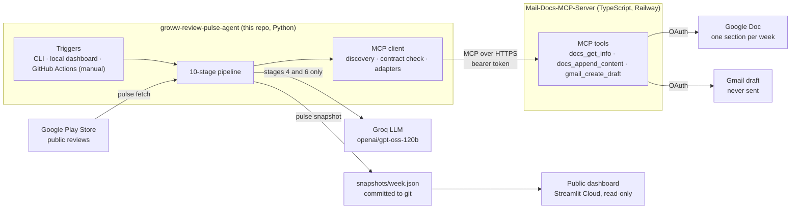

# Groww Review Pulse — agent

Turns public **Google Play Store** reviews of the Groww app into a **weekly one-page note**
(top 3 themes, 3 verbatim quotes, 3 action ideas, at most 250 words). It appends the note
to a **Google Doc** and creates a **Gmail draft**, never a sent email, through an
**MCP server**.

This repository is the **agent**: the analysis pipeline and the MCP client. It holds no
Google credential and has no Google SDK (a test enforces both). Google Docs and Gmail are
reached through a separate server,
[google-workspace-mcp](https://github.com/vikramragu/Mail-Docs-MCP-Server), which owns
OAuth and the Google API calls.

**The output, in short:** a product team gets one page each week saying which three
problems users complain about most, how much each grew against the previous 11 weeks,
three real user quotes, and three suggested actions. Every number is computed by code, and
every quote is checked word for word against a real review.

## Contents

- [Architecture](#architecture)
- [Why it is built this way](#why-it-is-built-this-way)
- [Tech stack](#tech-stack)
- [Three ways to run it](#three-ways-to-run-it)
- [Install](#install)
- [Configure](#configure)
- [Get review data](#get-review-data)
- [Run](#run)
- [Read the output](#read-the-output)
- [Dashboard](#dashboard)
- [Troubleshoot](#troubleshoot)
- [Development](#development)
- [Documentation](#documentation)

## Architecture

### System

Two repositories, deployed separately. The agent decides *what* to say; the MCP server is
the only thing that can touch Google.



### Pipeline

Each stage writes an artifact to `runs/<week>-<nn>/`, so any stage can be inspected or
replayed. Only two stages use the LLM; everything else is ordinary code.

```mermaid
flowchart LR
    S1["1 Ingest<br/>load export"] --> S2["2 Normalize<br/>dedupe, window,<br/>English, >8 words"]
    S2 --> S3["3 Scrub<br/>remove personal<br/>details"]
    S3 --> S4["4 Classify<br/>5 fixed themes<br/>(LLM, cached)"]
    S4 --> S5["5 Analyse<br/>count, compare with<br/>prior 11 weeks, rank"]
    S5 --> S6["6 Draft<br/>headline, summaries,<br/>actions (LLM)"]
    S6 --> S7{"7 Validate<br/>the gate"}
    S7 -- "fails: redraft,<br/>max 3 attempts" --> S6
    S7 -- "passes" --> S8["8 Render<br/>pulse.md"]
    S8 --> S9["9 Append<br/>to Google Doc"]
    S9 --> S10["10 Create<br/>Gmail draft"]

    classDef llm fill:#c6d7f2,stroke:#2c5bbf,color:#1b2a2f
    classDef gate fill:#f4cf86,stroke:#8a4a24,color:#1b2a2f
    classDef mcp fill:#bfe6d6,stroke:#1d7f80,color:#1b2a2f
    class S4,S6 llm
    class S7 gate
    class S9,S10 mcp
```



Blue: the LLM. Amber: the validation gate. Green: publishing through MCP.

**Stage 7, the gate,** checks before anything is published:

| Check | Rule |
| --- | --- |
| `word_limit` | At most 250 words |
| `three_three_three` | Exactly 3 themes, 3 quotes, 3 actions |
| `quotes_verbatim` | Each quote matches a real (scrubbed) review character for character |
| `no_pii` | No emails, phone numbers, account IDs or names |
| `figures_from_data` | No number written by the model; figures are printed by code |
| `grounded_in_themes` | Each action names one of the three themes on the page |

A note that fails is redrafted with the failure named; after three failures nothing is
published.

## Why it is built this way

The full record, with alternatives considered, is in
[docs/architecture.md §2](docs/architecture.md) and §19. The decisions that shape the
system:

| Decision | Why |
| --- | --- |
| **Code enforces every rule; the LLM is used only for judgement** (stages 4 and 6) | A model asked to keep to 250 words, quote exactly or avoid personal data will drift. Counting, ranking, the figures and the checks are code, so they are repeatable and testable. |
| **A fixed set of 5 themes**, plus "unclassified" | Themes invented fresh each week can't be compared week to week, which makes trends meaningless. A fixed list makes "+5.6 points vs the prior 11 weeks" a real number, and caps the note at 5 themes by construction. |
| **A doubtful label becomes "unclassified", never a guess** | A wrong theme silently inflates a trend. Unclassified reviews count toward the total but never toward a theme. |
| **Figures printed by code, hidden from the model** | A model restating counts can get them wrong, and nobody would notice. The model writes no digits at all; code prints the figures and the gate checks it. |
| **Personal details removed before any model call** (stage 3) | Reviews can contain phone numbers, emails or account IDs. Nothing identifying reaches the LLM, the Doc or git. |
| **Google access lives in a separate MCP server** | The agent holds no Google credential and has no Google SDK. Analysis and Google auth ship, deploy and fail independently, and the agent depends on a versioned tool contract, not on server code. |
| **Drafts only; the agent refuses any send tool** | A person reads every email before it goes out. The server also runs with sending disabled, so a leaked token can't send mail as the owner. |
| **Check the server before spending on the LLM** | A live run connects, checks the server's name, version and tools against the contract, and reads the doc, all before stage 1. A wrong token or a server that is down costs nothing. |
| **Re-runs don't duplicate** | A week already in the doc, or already drafted for it, is skipped. `--republish` overrides on purpose. |
| **Labels cached on disk** | The 12-week window overlaps about 90% between weeks, so a weekly run classifies only new reviews. |
| **Every stage writes an artifact** | Any failure can be inspected and replayed from that stage (`--from 6`, `--from 10`) without paying for the earlier ones again. |
| **Runs are started by a person, not on a schedule** | Someone decides when a week goes out. GitHub's Run workflow covers "no laptop needed" without an unattended job. |
| **Public dashboard reads a verified snapshot** | The public app never contacts the MCP server and holds no secrets. The snapshot withholds review IDs and private links, carries a SHA-256, and is re-checked on load. |
| **An LLM interface, not a vendor** (`LlmPort`) | Groq lets the project run without per-token spend; switching provider is a config change. |

## Tech stack

| Layer | Technology | Used for |
| --- | --- | --- |
| Language | Python 3.11+ | The whole agent |
| CLI | [Typer](https://typer.tiangolo.com/) | `pulse fetch`, `run`, `doctor`, `snapshot`, `validate`, `contract check` |
| Data models | [Pydantic v2](https://docs.pydantic.dev/) | Typed reviews, stats and the note; validating the model's JSON |
| LLM | [Groq](https://console.groq.com/), `openai/gpt-oss-120b` | Stage 4 (classify, batches of 40, temperature 0) and stage 6 (draft) |
| Review data | [google-play-scraper](https://pypi.org/project/google-play-scraper/) | `pulse fetch` only, never the pipeline |
| MCP client | [MCP Python SDK](https://github.com/modelcontextprotocol/python-sdk) 2.x | HTTPS with a bearer token, or stdio for the in-repo stub |
| Contract checks | [jsonschema](https://python-jsonschema.readthedocs.io/) | Every server reply against `contract/google-workspace-mcp-0.1.json` |
| Dashboard | [Streamlit](https://streamlit.io/), Altair, pandas | Local (with actions) and public (read-only) views |
| Tests | pytest, pytest-asyncio | 869 tests, fully offline, including a stub MCP server and a golden end-to-end run |
| Quality | Ruff (lint and format), mypy | Enforced in CI |
| CI and runs | GitHub Actions | `ci.yml` on every push; `weekly-pulse.yml` on demand |
| Hosting | Streamlit Community Cloud | The public dashboard |
| **Server** (other repo) | TypeScript, Node.js, Google Docs and Gmail APIs, OAuth 2.0, Railway | The MCP tools the agent calls |

## Three ways to run it

All three call the same `pulse` commands, so they can't disagree. None runs on a schedule.

| Way | Where | How |
| --- | --- | --- |
| **CLI** | Any machine with the secrets | `pulse fetch` then `pulse run` |
| **Local dashboard** | Your machine | **Fetch & analyse**, read the note, then **Publish** behind a confirmation |
| **GitHub Actions** | GitHub, no machine needed | Actions → **Weekly pulse** → Run workflow (tick *publish* to send it to the Doc and Gmail) |

The public dashboard on Streamlit Cloud is read-only: it shows the latest snapshot and has
no buttons, because a public button could publish to the team's Doc.

## Install

Requires Python 3.11 or later.

```bash
python -m venv .venv && source .venv/bin/activate
pip install -e ".[dev]"          # add ,scraper to use `pulse fetch`
pulse init-env                    # creates .env from .env.example
```

## Configure

### Secrets: `.env`

`.env` is gitignored. Real environment variables take precedence over it.

| Variable | What it is |
| --- | --- |
| `GROQ_API_KEY` | For stages 4 (classify) and 6 (draft). From [console.groq.com](https://console.groq.com) |
| `PULSE_MCP_TOKEN` | Bearer token for the MCP server. Must equal the server's `MCP_AUTH_TOKEN` |
| `PULSE_RECIPIENT` | Who the Gmail draft is addressed to |
| `PULSE_DOC_ID` | Optional. Overrides the doc in `config/pulse.toml`, e.g. to test against a scratch doc |

To make a token, run `openssl rand -hex 32` and set the same value as `MCP_AUTH_TOKEN` on
the server and `PULSE_MCP_TOKEN` here. Redeploy the server after changing it. Never paste a
token into a commit, a chat or a doc.

### The MCP server (Railway)

The agent needs `ENABLE_DOCS_APPEND` and `ENABLE_GMAIL_DRAFTS` on (the defaults). Set
`ENABLE_GMAIL_SEND=false`: the agent refuses to call a send tool anyway, and with it off a
leaked token cannot send mail as you. `ALLOWED_RECIPIENT_DOMAINS` and
`ALLOWED_DOCUMENT_IDS` narrow what a leaked token could do further.

### The Google Doc

The server cannot create or find documents, so the doc is created once by hand, in the
Google account the server is logged into. Each week is **appended** to it as a section
headed `Groww Review Pulse — <week>`. Put its ID (the part of the URL between `/d/` and
`/edit`) in `config/pulse.toml`:

```toml
[docs]
document_id = "1z2t…"
```

### Configuration files

| File | Purpose |
| --- | --- |
| `config/pulse.toml` | Window, thresholds, model, draft attempts, the doc, raw-data retention |
| `config/themes.toml` | The closed 5-theme taxonomy and its version |
| `config/mcp.toml` | The server URL, tool names, and the in-repo stub |

Then check everything:

```bash
pulse doctor            # every check; warnings do not fail it, problems do
pulse contract check    # the live server's tools still accept what the agent sends
```

## Get review data

```bash
pulse fetch --dry-run   # one page, report only
pulse fetch             # the configured window into data/raw/
```

`pulse fetch` downloads public Play Store reviews, newest first, and drops reviewer
identity before writing. It is deliberately not a pipeline stage, so the pipeline itself
never touches the network for data. There is no official review export for a non-owner of
the app, so it reads Google's public but undocumented endpoints;
[architecture.md O1](docs/architecture.md) explains that trade-off. Any file matching
[the export format](docs/input-format.md) works instead.

After writing a new export, `pulse fetch` deletes its own exports fetched before the window.
Files you dropped in by hand are never touched.

## Run

```bash
pulse run                       # the full weekly run: last complete week, publish live
pulse run --dry-run             # stages 1-8 only: writes pulse.md, touches no server
pulse run --week 2026-W41       # a specific ISO week
pulse run --mcp stub            # publish to the in-repo stub server instead
```

**Without a laptop:** GitHub → Actions → **Weekly pulse** → Run workflow does the same
fetch, analyse and (if ticked) publish, then updates the public dashboard. It runs only when
someone presses it. Setup and behaviour: [runbook](docs/runbook.md#every-week).

Before stage 1, a live run connects to the server, checks its name, version and tools, and
reads the configured doc. A wrong token, a missing doc or a server that is down therefore
stops the run **before** any model call costs money.

Each stage writes an artifact, so any stage can be replayed:

```bash
pulse run --from 6 --run-dir runs/2026-W41-02     # redraft from stored stats
pulse run --from 9 --run-dir runs/2026-W41-02     # publish an existing note
pulse run --from 10 --run-dir runs/2026-W41-02    # retry only the Gmail draft
pulse validate                                     # re-check the latest note
```

**Re-runs don't duplicate.** A week already appended to the doc is skipped, and so is a
week already drafted for that doc. `--republish` overrides both on purpose. This record is
kept locally in `runs/`, so a fresh checkout does not know which weeks were published.

### What it costs

Classifying the real 12-week corpus (about 1,700 reviews) is about 43 model calls, and
labels are cached in `.cache/classify.json`. A weekly run over an overlapping window
therefore classifies only new reviews. Drafting is one call, more if the validation gate
rejects a draft. Each run ends with a line of calls, tokens and cost.

## Read the output

Each run lives in `runs/<week>-<nn>/`:

| File | Contents |
| --- | --- |
| `01_raw.json` | Rows as exported, **unscrubbed**. Deleted once the run succeeds; kept if it fails |
| `02_normalized.json` | Typed, deduplicated, in-window, substantive (English, more than 8 words) |
| `03_scrubbed.json` | Personal details removed. The first artifact safe to share |
| `04_classified.json` | A theme (or none) per review id. No review text |
| `05_stats.json` | Every theme ranked, with figures and quote candidates |
| `06_note.json` | The note as structured data |
| `07_validation.json` | Every draft attempt and why it was rejected |
| `pulse.md` | The note as published |
| `09_published.json` / `10_draft.json` | Where it went: doc URL, draft id, appended or skipped |
| `run.json` | The ledger: per-stage timings and outcomes, counts, model usage per stage. Never review text |

What the note's numbers mean:

- **"1,708 substantive reviews of 8,812 in window"**: themes are measured on reviews of
  more than 8 English words. Short reviews are mostly praise and long ones mostly
  complaints, so these figures describe what people complain about, not overall sentiment.
- **"(37 reviews, 25.7% of week, +5.6 pts vs prior 11 wks, 2.6★)"**: printed by code from
  the data, never written by the model. "+5.6 pts" is the change in the theme's share of
  the week against the previous weeks, in percentage points. ▲ / ▼ / → means up, down, or
  within one point.
- **Quotes** are checked character for character against real (scrubbed) reviews. Their
  star rating comes from that review, not from the model.
- **Themes are ranked**, not only counted: how negative a theme is and how fast it is
  rising both count, so the biggest theme is not always first.

## Dashboard

```bash
pip install -e ".[ui]"
streamlit run frontend/streamlit_app.py
```

Five tabs: the weekly pulse and its six checks, all five themes ranked with quotes and
actions, review statistics (theme share by week, star ratings, export → analysis funnel),
delivery, and health and settings.

| | Local (`runs/` present) | Public (Streamlit Cloud) |
| --- | --- | --- |
| Data | Any run in `runs/` | The latest `snapshots/<week>.json` |
| Checks | Recomputed against the candidate pools | Recomputed on load; SHA-256 must match; verbatim recorded at export |
| Actions | **Fetch & analyse** (publishes nothing), then publish to the Doc + draft behind a confirmation, which also writes the snapshot; run `pulse doctor` | None: read-only |

Buttons call the `pulse` CLI, so the dashboard and the terminal can't disagree. Nothing is
scheduled: a week runs when someone presses a button (here or GitHub's Run workflow) or types `pulse run`
([runbook](docs/runbook.md#every-week)). Local mode turns on when `runs/` has a finished
run or a `.env` exists.
`PULSE_UI_MODE=snapshot` previews the public view locally. The app lives in [frontend/](frontend/).

**Updating the public view.** After a week is published:

```bash
pulse snapshot                      # latest finished run -> snapshots/<week>.json
git add snapshots && git commit -m "snapshot: <week>" && git push
```

A snapshot holds the published note (including its three quotes) and figures. It
withholds review ids, every other review's text, the draft id and the private doc link.
Export refuses a note that fails a check, or anything the PII scanner flags.

**Deploying on Streamlit Community Cloud:** New app → this repository, branch `main`, main
file `frontend/streamlit_app.py`. Dependencies come from `requirements.txt`. No secrets are needed:
the public app never contacts the MCP server.

## Troubleshoot

`pulse doctor` names most problems directly. Common ones:

| Symptom | Fix |
| --- | --- |
| `rejected our token (HTTP 401)` | `PULSE_MCP_TOKEN` ≠ the server's `MCP_AUTH_TOKEN`, or the server was not redeployed after the change |
| `could not be reached` | Server down or asleep: open `<server>/healthz`, check Railway |
| `Document not found or not shared` / `No edit access` | Wrong doc ID, or the doc isn't in or shared with the server's Google account, or it isn't on `ALLOWED_DOCUMENT_IDS` |
| `Google authorization required` | The server's Google login expired. Re-authorize it ([runbook](docs/runbook.md#when-a-run-fails)); if it happens weekly, its OAuth app is in Testing status |
| `Recipient domain not allowed` | `PULSE_RECIPIENT` is outside the server's `ALLOWED_RECIPIENT_DOMAINS`. The doc is already published; fix it and run `--from 10` |
| `Only N review(s) in <week>` | That week is too thin to report on. Check `--week`, or fetch fresh data |
| `No compliant note after 3 attempt(s)` | See `07_validation.json` for what the model kept getting wrong. Nothing was published |
| Warning that the server exposes `gmail_send_email` | `ENABLE_GMAIL_SEND` is on again on Railway. The agent will not call it, but turn it off |
| Week shows `skipped` | Already published to this doc. That's intended; use `--republish` to add it again |

The weekly routine and how to recover from each failure are in
[docs/runbook.md](docs/runbook.md).

## Development

```bash
pytest -q                       # offline: no network, no real server, no tokens
ruff check . && ruff format --check . && mypy src
UPDATE_GOLDEN=1 pytest tests/test_golden.py    # after an intended change to the note
```

The tests run the MCP layer against an in-repo stub of the real server
(`tests/stubs/stub_mcp_server.py`), over both stdio and HTTP. `tests/test_golden.py` runs
the whole pipeline end to end, offline, against `tests/fixtures/pulse_golden.md`.

Test fixtures are synthetic. Never commit real reviews: `data/raw/` and `runs/` are
gitignored.

## Documentation

| Document | Contents |
| --- | --- |
| [docs/problemStatement.md](docs/problemStatement.md) | Requirements, constraints, acceptance checklist |
| [docs/architecture.md](docs/architecture.md) | Design and decisions; §11 the MCP layer, §15 failure modes |
| [docs/implementation-plan.md](docs/implementation-plan.md) | Phase-by-phase build log |
| [docs/project-context.md](docs/project-context.md) | Handoff summary: status, decisions, what's pending |
| [docs/runbook.md](docs/runbook.md) | Weekly operation and recovery, including the snapshot |
| [docs/input-format.md](docs/input-format.md) | The review export format |
