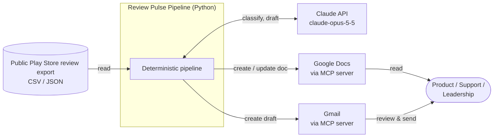
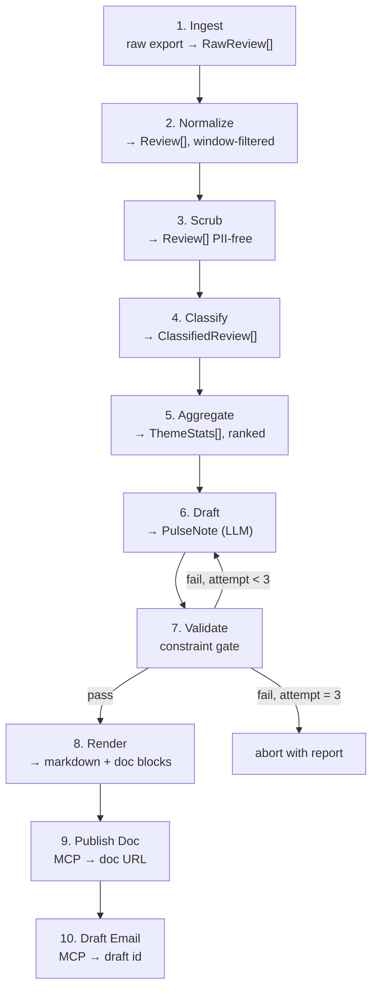

# Groww Review Pulse — Architecture

> Design document for the system described in [problemStatement.md](problemStatement.md).
> Status: **proposed** — no code exists yet. Last updated: 2026-10-09.

---

## 1. Purpose and Scope

This document specifies the **agent** of the Review Pulse system: the component that converts
public **Google Play Store** reviews of the Groww app into a weekly one-page pulse, then publishes
it to Google Docs and creates a Gmail draft by **calling MCP servers it does not own**.

**Store scope: Play Store only.** The Apple App Store is deferred — see [D10](#2-resolved-decisions).

### 1.1 Two-project split

The system is built as two separate projects with their own problem statements, architectures, and
implementations:

| Project | Role | Owns |
| --- | --- | --- |
| **`agent-mcp`** (this repo) | **Agent / MCP client.** The analytical pipeline and the consumer of MCP tools. | Ingestion, scrubbing, classification, note generation, constraint enforcement, orchestration, MCP client sessions |
| **MCP servers project** (separate repo) | **MCP servers.** Exposes Google Docs and Gmail as MCP tools. | Google OAuth, token storage and refresh, Google REST calls, tool schemas, rate-limit handling |

The boundary is the **MCP tool contract** in [§11.2](#112-the-tool-contract-what-this-agent-requires).
Everything the agent needs from Google reaches it through that contract and nothing else.

**In scope here:** ingestion, PII scrubbing, theme classification, note generation, constraint
enforcement, orchestration, MCP client wiring, the tool contract this agent requires, testing
against a contract-conforming stub.

**Out of scope here:** Google OAuth and credential storage, Google Docs/Gmail REST calls, MCP
server implementation, token refresh — all of that belongs to the servers project. Also out of
scope: **Apple App Store / iOS reviews** (deferred, D10), a hosted scheduler, multi-product
support, review reply automation, sentiment dashboards. (A web UI was out of scope until
D11 added a read-mostly dashboard.)

### 1.2 What the split changes

Writing both sides is a different problem from integrating a third-party server, in two ways that
matter:

1. **The contract is ours to specify, not to discover.** §11.2 states the tool surface the agent
   requires as a normative spec. It is an input to the servers project, not a description of
   something that already exists.
2. **Neither project may block the other.** The agent develops against a stub server generated from
   that spec; the servers project validates against the same spec. The two meet at integration
   rather than at the start.

The runtime contract stays narrow on purpose — four tools. A broad surface would couple the two
projects' release cycles together for no gain.

---

## 2. Resolved Decisions

| # | Decision | Choice | Rationale |
| --- | --- | --- | --- |
| D1 | Language / runtime | **Python 3.11+** | Mature MCP Python SDK, Anthropic SDK, Pydantic for schema contracts, strong text tooling. |
| D2 | Review ingestion | **Pluggable adapters; file-drop is the primary and only initial adapter** | The brief mandates "public exports only." A file-drop adapter is unambiguously compliant, deterministic, and testable offline. |
| D3 | Orchestration shape | **Deterministic spine; LLM for the two judgment steps** | Every hard constraint (≤5 themes, ≤250 words, verbatim quotes, no PII) is enforced by code. An LLM asked to self-police these will drift. |
| D4 | Theme taxonomy | **Fixed, closed set of 5 themes + a non-theme `unclassified` bucket** | Free clustering per run produces incomparable themes week over week, which kills trend reporting. A fixed taxonomy makes deltas meaningful and guarantees the ≤5 cap structurally. |
| D5 | Cadence | **Weekly run over a rolling 8–12 week corpus** | Satisfies both the "8–12 weeks" import requirement and "weekly pulse": the corpus provides the baseline, the note covers the most recent ISO week with deltas against it. |
| D6 | LLM | **Provider-agnostic `LlmPort`; Groq for both LLM stages initially** | Superseded the original choice of `claude-opus-5-5` (see D6a). Only stages 4 and 6 call a model, and every hard constraint is enforced in code rather than by the model, so the provider is a configuration choice rather than an architectural one. |
| D6a | Why the provider changed | **Groq, decided 2026-10-11** | Chosen to build and demo without per-token spend. The cost is Anthropic-style prompt caching, which Groq has no equivalent for (see §8.1); the on-disk classification cache absorbs most of that loss. The `LlmPort` abstraction keeps a switch back to `claude-opus-5-5` a config change, not a rewrite. |
| D7 | Publishing | **Direct MCP tool calls from the pipeline**, not an agent loop | Publishing is a deterministic side effect; no model judgment is needed once the note exists. Keeps the step idempotent and unit-testable. |
| D8 | MCP servers | **Built in a separate project; this repo is the client only** | Separates Google auth and REST concerns from analysis concerns, and lets the two halves ship independently. The agent depends on a versioned tool contract, not on a server implementation. |
| D9 | Contract ownership | **Agent-side spec (§11.2), versioned, mirrored into the servers project** | We own both sides, so the interface must be written down once and referenced by both — otherwise it lives only in whichever codebase was edited last. |
| D10 | Store scope | **Google Play Store only; Apple App Store deferred** | The brief names both stores but supplies only a Play Store URL, and the product is Android-first. One store removes a whole adapter, a second export format, and cross-store normalization questions (differing rating semantics, locale handling, date formats) from the critical path. The `source` field is retained so re-adding iOS is additive. |
| D11 | Dashboard | **A Streamlit view over runs (local) and a verified snapshot (public)**, added 2026-10-19 | A CLI is invisible to reviewers and stakeholders. The dashboard adds no logic: `pulse.ui.data` loads the same artifacts and re-runs the same gate, and its buttons call the `pulse` CLI. Publicly it serves only `snapshots/<week>.json`, which withholds review ids, quote candidates, the draft id and the private doc link, carries a SHA-256, and is re-checked on load. Its three published quotes are a deliberate exception to "no real reviews in git": they are already public, anonymous and scrubbed, and are what the note exists to show. |

---

## 3. Architectural Drivers

The brief's constraints are not soft preferences, so each one is mapped to a specific enforcement
point in code. This table is the spine of the design.

| Constraint | Enforcement mechanism | Where | Fails how |
| --- | --- | --- | --- |
| Public exports only | No network fetch in the default adapter; adapter registry is explicit opt-in | `ingest/` | Structurally impossible to violate by default |
| Play Store only (D10) | `Source` enum has one member | `models.py` | Schema validation error on any other source |
| 8–12 week window | Date-range filter applied at normalization | `normalize.py` | Run aborts if corpus window is outside tolerance |
| Analysable corpus | Substance filters: letters present, Latin script, not romanized Hindi, more than 8 words | `normalize.py` | Counted per reason; both totals disclosed in the note |
| ≤5 themes | Closed `Theme` enum — the model classifies *into* it, never invents | `models.py` | Schema validation error |
| Top 3 themes in note | Deterministic ranking + slice before the note prompt | `aggregate.py` | n/a — code picks, not the model |
| 3 quotes | Schema `min_length=3, max_length=3` (Pydantic v2 list constraints) | `models.py` | Schema validation error |
| Quotes verbatim | **Substring verification against the scrubbed corpus** | `validate.py` | Rejected; bounded regeneration |
| 3 action ideas | Schema `min_length=3, max_length=3` | `models.py` | Schema validation error |
| ≤250 words | Word count on the rendered body | `validate.py` | Rejected; bounded regeneration |
| No PII | Scrub **before** the corpus reaches the model; re-scan every artifact before publish | `scrub.py`, `validate.py` | Run aborts |
| MCP-first | No `googleapiclient`, no OAuth code, no Google REST URLs in the dependency tree | `publish/` | Enforced by a dependency-denylist test |

Two of these deserve emphasis because they are the most common way this kind of system quietly
fails:

**Verbatim quotes.** A model asked for "verbatim snippets" will routinely tidy grammar, trim
filler, or merge two sentences. The only reliable defense is mechanical: every returned quote must
appear as an exact substring of exactly one stored review's scrubbed text. Normalize whitespace on
both sides before comparing, then reject anything that does not match and regenerate with the
failing quote named in the feedback.

**PII ordering.** Scrubbing runs *before* classification, not before publishing. If scrubbing came
last, raw PII would already have been sent to the model and written into intermediate run
artifacts. Putting it immediately after normalization means no component downstream of stage 2 ever
holds identifiable data, and the pre-publish scan becomes a cheap assertion rather than the primary
control.

---

## 4. System Context



The pipeline is the only component that holds state. Claude is stateless per call. The two Google
surfaces are reached exclusively through MCP servers, which own all credentials.

**Project boundary.** The dashed boundary below is the deliverable split from §1.1 — everything
right of it is the separate servers project:

```text
   this repo (agent)                    │   separate servers project
   ─────────────────────────────────────┼──────────────────────────────────
   ingest → scrub → classify →         │
   aggregate → draft → validate →      │
   render → MCP client ────────────────┼──► Docs MCP server ──► Google Docs
                                        │    Gmail MCP server ──► Gmail
                                        │    (owns OAuth + tokens)
                    contract: pulse-mcp/1
```

---

## 5. Component View

```text
┌──────────────────────────────────────────────────────────────────────┐
│ CLI / entrypoint            pulse run --week 2026-W41               │
├──────────────────────────────────────────────────────────────────────┤
│ Orchestrator                stage sequencing, run ledger, retries   │
├───────────────┬───────────────┬───────────────┬──────────────────────┤
│ Ingestion     │ Analysis      │ Rendering     │ Delivery             │
│               │               │               │                      │
│ adapters/     │ scrub.py      │ render.py     │ publish/docs.py      │
│  file_drop.py │ classify.py   │ validate.py   │ publish/gmail.py     │
│  base.py      │ aggregate.py  │               │ mcp/session.py       │
│ normalize.py  │ draft.py      │               │                      │
├───────────────┴───────────────┴───────────────┴──────────────────────┤
│ Cross-cutting   models.py (Pydantic)  config.py  llm.py  logging.py │
└──────────────────────────────────────────────────────────────────────┘
```

**Layering rule:** dependencies point inward to `models.py`. `ingest/` never imports `publish/`.
`analysis/` never imports MCP. This keeps every stage independently testable with fixtures.

**Boundary rule:** only `mcp/` and `publish/` know that MCP exists, and only `mcp/` knows tool
names. The rest of the agent is unaware the servers project exists at all — which is what makes the
server swap in §11.4 (stub → live) a config change.

---

## 6. Pipeline Stages and Contracts

Each stage is a pure function over its input type where possible, writing its output to
`runs/<run_id>/` as a JSON artifact. That makes every stage independently replayable — a note
regeneration does not re-classify 1,200 reviews, and a publish retry does not re-run the LLM.



### Stage detail

| # | Stage | Input | Output | Deterministic? | Notes |
| --- | --- | --- | --- | --- | --- |
| 1 | Ingest | export file | `RawReview[]` | Yes | Adapter-selected; no network by default |
| 2 | Normalize | `RawReview[]` | `Review[]` | Yes | Field coercion, date parsing, dedupe by content hash, window filter |
| 3 | Scrub | `Review[]` | `Review[]` | Yes | PII removal; **hard gate** before any model call |
| 4 | Classify | `Review[]` | `ClassifiedReview[]` | No (LLM) | Batched, closed-enum output, cached by content hash |
| 5 | Aggregate | `ClassifiedReview[]` | `ThemeStats[]` | Yes | Counts, mean rating, WoW delta, ranking, quote candidate pool |
| 6 | Draft | `ThemeStats[]` + candidates | `PulseNote` | No (LLM) | Structured output; sees only scrubbed text |
| 7 | Validate | `PulseNote` | `PulseNote` | Yes | Word count, quote verbatim check, PII rescan, cardinality |
| 8 | Render | `PulseNote` | markdown | Yes | Single source of truth for doc + email bodies |
| 9 | Publish Doc | markdown | doc URL | Yes | MCP; idempotent by doc title convention |
| 10 | Draft Email | markdown + URL | draft id | Yes | MCP; never sends |

---

## 7. Data Model

Pydantic models in `models.py` are the contract between stages and the schema handed to the model
for structured outputs.

```python
from datetime import date
from enum import StrEnum
from typing import Annotated, Literal
from pydantic import BaseModel, ConfigDict, Field, StringConstraints

# ISO week label, e.g. "2026-W41". Constrained because the ISO-year boundary is a
# silent-corruption trap: 2027-01-01 belongs to 2026-W53, and formatting with the
# calendar year instead would misfile reviews without failing.
IsoWeek = Annotated[str, StringConstraints(pattern=r"^\d{4}-W(0[1-9]|[1-4][0-9]|5[0-3])$")]


class Source(StrEnum):
    """Review origin. Play Store only for now (D10); iOS would add APP_STORE here."""
    PLAY_STORE = "play_store"


class Theme(StrEnum):
    """Closed taxonomy. Exactly five themes — this enum *is* the ≤5 constraint."""
    ONBOARDING_KYC       = "onboarding_kyc"
    ORDERS_EXECUTION     = "orders_execution"
    PAYMENTS_WITHDRAWALS = "payments_withdrawals"
    APP_RELIABILITY      = "app_reliability"
    CHARGES_SUPPORT      = "charges_support"


class RawReview(BaseModel):
    """Whatever the export provided, untyped and unvalidated beyond presence."""
    model_config = {"extra": "allow"}
    source: Source                      # only PLAY_STORE while iOS is deferred (D10)
    external_id: str | None = None
    rating: int | None = None
    title: str | None = None
    text: str | None = None
    submitted_at: str | None = None


class Review(BaseModel):
    """Normalized, scrubbed. No reviewer identity fields exist on this model by design."""
    model_config = ConfigDict(extra="forbid")   # see "structural PII defence" below

    review_id: str                      # content hash — stable, non-identifying
    source: Source
    rating: Annotated[int, Field(ge=1, le=5)]
    text: Annotated[str, StringConstraints(min_length=1)]
    submitted_on: date
    iso_week: IsoWeek
    scrubbed: bool = True


class ClassifiedReview(BaseModel):
    review_id: str
    theme: Theme | None                 # None == unclassified; not a 6th theme
    confidence: Annotated[float, Field(ge=0, le=1)]


class QuoteCandidate(BaseModel):
    """A quotable review, carrying the provenance a quote drawn from it needs."""
    review_id: str
    text: str
    rating: Annotated[int, Field(ge=1, le=5)]


class ThemeStats(BaseModel):
    theme: Theme
    review_count: int
    share_of_week: float
    mean_rating: float
    delta_vs_baseline: float            # share change vs trailing weeks
    quote_candidates: list[QuoteCandidate]   # verbatim, scrubbed, ranked, with provenance


class Quote(BaseModel):
    text: Annotated[str, StringConstraints(min_length=20, max_length=240)]
    theme: Theme
    rating: Annotated[int, Field(ge=1, le=5)]
    review_id: str                      # provenance for the verbatim check


class ActionIdea(BaseModel):
    theme: Theme
    action: Annotated[str, StringConstraints(max_length=160)]
    rationale: Annotated[str, StringConstraints(max_length=200)]


class ThemeSummary(BaseModel):
    theme: Theme
    summary: Annotated[str, StringConstraints(max_length=220)]
    review_count: int
    direction: Literal["up", "down", "flat"]


class PulseNote(BaseModel):
    """The LLM's structured output. Cardinality constraints are enforced here."""
    iso_week: IsoWeek
    headline: Annotated[str, StringConstraints(max_length=100)]
    top_themes: Annotated[list[ThemeSummary], Field(min_length=3, max_length=3)]
    quotes: Annotated[list[Quote], Field(min_length=3, max_length=3)]
    actions: Annotated[list[ActionIdea], Field(min_length=3, max_length=3)]
```

**Structural PII defence.** Note what is *absent* from `Review`: no username, no reviewer name, no
device id, no email, no app-version-plus-device fingerprint. The schema itself prevents a careless
adapter from carrying identity forward — there is nowhere to put it. `extra="forbid"` makes that
defence loud rather than silent: Pydantic's default would quietly drop an `author=` an adapter
passed in, which is safe but hides the bug. Rejecting it surfaces the mistake at the stage boundary
that produced it.

**On `StrEnum` rather than `(str, Enum)`.** Not cosmetic. With `(str, Enum)`,
`f"{Theme.APP_RELIABILITY}"` renders as `"Theme.APP_RELIABILITY"`, not `"app_reliability"` — and
§8.1 renders theme names straight into the classifier prompt, so that spelling would degrade
classification with no error anywhere. Pydantic's serialized JSON and generated schema are
identical either way, so structured outputs are unaffected.

**On `Source` having one member.** A single-valued enum looks like dead weight, but keeping the
field does two things a bare removal would not. It keeps store provenance in every stored artifact,
so a corpus collected now stays interpretable if iOS is added later; and it makes adding the App
Store a purely additive change — one enum member, one adapter — rather than a schema migration
across `runs/` history. Meanwhile the narrow type stops an adapter from quietly emitting an
out-of-scope source. The cost is one line; the alternative is re-deriving provenance later from
whatever file a review happened to arrive in.

### Proposed theme taxonomy

Derived from what a discount-broking app's review flow actually concerns. Fits the brief's "pick
what fits your product" instruction; the examples it gave (onboarding, KYC, payments, statements,
withdrawals) are folded in.

| Theme | Covers |
| --- | --- |
| `onboarding_kyc` | Signup, KYC/eKYC, document upload, verification delays, account activation |
| `orders_execution` | Order placement/failure, price feeds, charts, watchlists, IPO applications, execution slippage |
| `payments_withdrawals` | UPI/netbanking deposits, withdrawal delays, settlement timing, failed/stuck transfers, refunds |
| `app_reliability` | Crashes, login failures, slowness, OTP issues, upgrade breakage, downtime during market hours |
| `charges_support` | Brokerage/AMC/hidden charges, statements and reports, support responsiveness, account closure |

If the live corpus shows a dominant topic none of these hold, change the enum — do not add a sixth.

---

## 8. Analysis Subsystem

### 8.1 Classification (stage 4)

Per-review classification into the closed enum, batched to amortize prompt cost.

- **Batching:** ~40 reviews per request, each tagged with a **1-based index within the batch**; the
  model returns an array of `{index, theme, confidence}`, and the agent maps indices back to review
  ids locally. An index rather than the `review_id` because a small integer is far harder for a
  model to corrupt than a 16-character hex hash, an out-of-range index is detectable where a
  plausible-looking wrong hash is not, and it costs fewer output tokens.
- **Reconciliation, not zipping:** the returned index set is checked against `1..n`. A missing,
  duplicated, or out-of-range index yields `theme = None` and is counted in the ledger. Pairing
  results with the input list positionally would mislabel reviews silently — the same class of
  failure as a paraphrased quote.
- **Structured outputs:** the request carries the JSON Schema generated from a Pydantic wrapper
  model, and the response is validated against that same model. The enum is in the schema, so an
  invented theme is a validation error rather than silent corruption. Validation happens
  **client-side regardless** of whether the provider enforced the schema, so a provider that only
  offers best-effort JSON degrades to "more retries", never to wrong data.
- **Classification cache:** keyed by `(review_id, taxonomy_version)` in `.cache/classify.json`.
  Re-runs over an overlapping corpus skip the call entirely, which matters because the 8–12 week
  window overlaps ~90% between consecutive weekly runs. This is the primary cost lever.
- **Low confidence:** below 0.5 → `theme = None`. Unclassified reviews count toward the corpus
  total but never toward a theme, so they cannot manufacture a false trend.

**Prompt caching is provider-dependent.** Anthropic offers an explicit `cache_control` breakpoint,
which would let the stable taxonomy prefix be cached and re-read across batches; Groq has no
equivalent. The agent therefore treats it as an optimization to assert only where the provider
supports it (`LlmPort.supports_prompt_cache`), and leans on the on-disk classification cache above
for the property that actually matters — a weekly re-run over an overlapping corpus being nearly
free. Losing prompt caching costs input tokens within a single run; losing the on-disk cache would
cost a whole re-classification.

```python
class ClassificationBatch(BaseModel):
    results: list[ClassifiedReview]


response = llm.generate_json(
    system=TAXONOMY_PROMPT,                 # stable; cached where the provider supports it
    user=render_batch(reviews),             # volatile, so it goes last
    schema=json_schema_for(ClassificationBatch),
    max_tokens=8000,
)
batch = ClassificationBatch.model_validate_json(response.text)
```

### 8.2 Aggregation (stage 5) — deterministic

No model involvement. This is where "top themes" is decided, so it must be reproducible.

**Ranking score** per theme for the target week:

```text
score = 0.6 · share_of_week
      + 0.25 · normalized_negative_volume      # count of 1–2★ reviews in theme
      + 0.15 · max(0, delta_vs_baseline)       # rewards emerging problems
```

Rationale: raw volume alone buries a sharp new regression under a chronically large theme, and
delta alone over-reacts to small-sample noise. Weighting volume primarily, severity second, and
momentum third puts a genuinely emerging payment outage onto the page without letting a
three-review blip displace a standing complaint. Tie-break on negative volume, then theme name for
stability.

**Quote candidate selection** — the pool handed to the drafting step, not the final choice:

1. Filter to the target week and the theme.
2. Drop reviews under 40 or over 240 characters (too thin to quote; too long for a one-pager).
3. Drop any review whose scrubbed text still contains a scrub placeholder — a partially redacted
   quote reads badly and risks leaking context.
4. Rank by a readability heuristic (sentence count, absence of emoji runs, presence of a concrete
   noun) and take the top 8 per theme.

The model picks 3 from this pre-vetted pool. It cannot quote anything outside it, which bounds the
verbatim check to a small set.

### 8.3 Drafting (stage 6)

One LLM call producing the whole `PulseNote` as a structured output.

- **Input:** ranked `ThemeStats` for the top 3 themes, their quote candidate pools, week metadata,
  and the aggregate numbers. Not the full corpus — the model does not need 1,200 reviews to write
  250 words, and withholding them removes any temptation to quote outside the pool.
- **Effort:** `high` — this is the quality-sensitive step.
- **Prompt constraints:** the ≤250-word budget stated explicitly, quotes required to be copied
  character-for-character from the supplied candidates, actions required to name a theme.
- **No forced tool use:** `tool_choice: any`/`tool` returns a 400 on `claude-opus-5-5`. Structured
  outputs via `output_format` is the correct mechanism here anyway.

```python
response = client.messages.parse(
    model="claude-opus-5-5",
    max_tokens=4000,
    output_config={"effort": "high"},
    system=DRAFT_SYSTEM_PROMPT,
    messages=[{"role": "user", "content": render_draft_input(stats, candidates)}],
    output_format=PulseNote,
)
```

---

## 9. Validation Gate (stage 7)

The gate that makes the hard constraints real. Runs entirely in code, no model involvement.

| Check | Rule | On failure |
| --- | --- | --- |
| Cardinality | 3 themes, 3 quotes, 3 actions | Pydantic rejects at parse time |
| Theme validity | Each theme ∈ `Theme` and ∈ the top-3 the aggregator chose | Regenerate |
| **Verbatim** | Each `quote.text`, whitespace-normalized, is an exact substring of exactly one candidate's scrubbed text | Regenerate, naming the offending quote |
| Provenance | **Derived, not checked**: `review_id` and `rating` are overwritten from the matched candidate | n/a — the model's values are discarded |
| **Word count** | Rendered body ≤ 250 words | Regenerate with the measured count |
| **PII rescan** | Full scrub detector finds nothing in the rendered note | **Abort the run** |
| Distinctness | The 3 quotes come from 3 distinct reviews | Regenerate |
| Action grounding | Each action's theme ∈ the top 3 | Regenerate |

**Regeneration loop:** at most 3 attempts. Each retry appends the specific failures as feedback —
not a bare "try again," which tends to produce a differently-wrong note. After 3 failures the run
aborts and writes a validation report; it does not publish a non-compliant note.

**Provenance is derived rather than validated.** An earlier version of this section
specified checking that `quote.review_id` matched its source — but §7 typed
`quote_candidates` as `list[str]`, which made that check unimplementable, and left
`review_id` and `rating` as fields the model filled in freely. It did: a real run produced
invented ids (`r001`, `r002`) and guessed star ratings sitting beside correctly verified
quote text. A verbatim quote under the wrong rating is still a misleading artifact. So
candidates now carry provenance and stage 7 overwrites both fields from the matched
review; the model's values are discarded unread, and the count of corrections is recorded
in the ledger.

**PII failure is an abort, not a retry.** A PII hit at this point means stage 3 has a gap. Retrying
the drafting step would be treating a scrubber bug as a drafting problem, and might well succeed by
luck while leaving the real defect in place.

**Word count definition** (stated precisely because it is an enforced constraint): whitespace-split
tokens in the rendered note body, excluding the title line, the metadata line (week, review count,
generated-at), markdown syntax characters, and the themes' numeric annotations. Quote text and
action text count. Implemented in one function, `count_note_words()`, with its own unit tests —
a constraint whose measurement is ambiguous is not enforced.

---

## 10. PII Scrubbing (stage 3)

Defense in depth, applied before any model call.

**Layer 1 — structural.** Identity fields are dropped at normalization. The `Review` model has no
field to hold a username and forbids extras, so an adapter cannot carry one forward even by
mistake. In practice the file-drop adapter drops recognised identity columns one stage earlier, at
ingest, so they are absent from every artifact rather than merely from stage 2 onward.

**Layer 2 — pattern redaction** over review text:

| Class | Approach | Replacement |
| --- | --- | --- |
| Email | regex | `[email]` |
| Phone (Indian + international) | regex, 10–13 digits with optional `+91`/separators | `[phone]` |
| PAN | `[A-Z]{5}[0-9]{4}[A-Z]` | `[id]` |
| Aadhaar | 12-digit, Verhoeff checksum to cut false positives | `[id]` |
| Bank / demat / client account numbers | 9–18 digit runs, and `\b[A-Z]{4}0[A-Z0-9]{6}\b` for IFSC | `[account]` |
| UPI handle | `\S+@(okaxis\|oksbi\|okhdfcbank\|ybl\|paytm\|upi\|…)` | `[upi]` |
| URL | regex | `[link]` |
| `@handle` | regex | `[handle]` |
| Long digit runs (catch-all) | ≥9 digits, optionally split by single spaces or hyphens, not already matched. Counts digits, not characters, so an ISO date (8 digits) is not redacted | `[number]` |

**Layer 3 — self-identification.** Patterns like `my name is X`, `I am X from Y`, and
`contact me at` redact the trailing span. Deliberately conservative: it will occasionally redact a
non-name, which costs a quote candidate. That is the right trade — a lost candidate is invisible to
the reader, while a leaked name violates a hard constraint.

**Layer 4 — the pre-publish rescan** in stage 7, running the same detector over the rendered note.

### Substance filtering (stage 2) and the sampling bias it introduces

A third of real Groww reviews are a single word ("good", "ok", "nice") and two thirds are
three words or fewer. The rule, decided 2026-10-15: **classify only English reviews of more
than 8 words.** Four checks in stage 2 implement it, applied in this order and counted
under the first one that fires, so the cost of each is visible:

| Rule | Why | Removed from the real 12-week corpus (8,812 in window) |
| --- | --- | --- |
| No letters at all (emoji, punctuation) | Nothing to classify | 231 (2.6%) |
| More than 30% non-Latin letters | A script the English classifier prompt cannot read | 145 (1.6%) |
| Romanized Hindi (Hinglish) | Not English, though in Latin script | 471 (5.3%) |
| Fewer than `min_review_words` (default **9**) | No topic to find | 6,257 (71%) |
| **Kept** | | **1,708 (19.4%)**, ≥86 in every week |

Only tokens containing a letter count as words, so emoji and bare numbers ("₹500") cannot
pad a review over the floor.

**The filtering is load-bearing, not cosmetic.** Left in, these reviews land in
`unclassified` and swell the denominator every theme share is measured against — "payments
was 25% of the week" would be mostly measuring noise.

**Romanized Hindi is detected with a word list, not a model.** `HINDI_MARKERS` holds
Hindi function words that are not also English words (so "me", "main", "to" are excluded);
`ENGLISH_MARKERS` holds English function words. A review is dropped when ≥20% of its words
are Hindi markers and <15% are English markers, or when Hindi markers alone reach 40%.
English reviews that borrow a word ("paisa still not credited") are kept. The lists are
versioned (`ROMANIZED_LEXICON_VERSION`, recorded in the stage 2 report) so a shift in
corpus size between runs can be traced to the lexicon. A language-ID library was rejected:
it would make `02_normalized.json` depend on a model and a library version, and its
mistakes could not be pinned as test cases. Measured on 109 inspected real reviews: no
English review dropped, about 4% of kept reviews still non-English (mostly Hinglish
spelling "hai" as "he", which cannot be listed because "he" is English).

**These filters are sample selection, and they are not neutral.** The language rules
remove users who write in Indian languages — plausibly those having the most onboarding
and KYC difficulty. The word floor removes brief reviewers, who skew positive: 77% of the
raw corpus is 5★, but in the kept corpus 1★ (705) outnumbers 5★ (606). So a theme share,
and a theme's mean rating, describe *substantive English-language* reviews, not Groww's
users.

The mitigation is disclosure rather than correction: the ledger keeps `corpus_total`
alongside `corpus_size`, and the rendered note's metadata line states both —
`1,708 substantive reviews of 8,812 in window`. Without that, a reader takes the share for
a population statistic. The floor is configurable (`thresholds.min_review_words`); lowering
it recovers the 4–8 word band, which contains genuinely classifiable text like "withdrawal
pending since last week".

A quote that still contains a placeholder after scrubbing is dropped from the candidate pool rather
than published with `[phone]` in the middle of it.

**Not used: LLM-based PII detection.** It is non-deterministic, unauditable, and would require
sending unscrubbed text to the model — which is precisely the thing to avoid.

---

## 11. MCP Integration Layer

The brief's central technical requirement: Docs and Gmail are reached only through MCP. The
pipeline holds no Google credentials and contains no Google REST calls.

Per [D8](#2-resolved-decisions), the servers are a **separate project**. This section therefore has
two jobs: specify the contract this agent requires of them (§11.2), and describe the client that
consumes it (§11.1, §11.3).

### 11.0 As built (Phase 5, 2026-10-16) — read this first

The servers project shipped as **`google-workspace-mcp` 0.1.0**
([vikramragu/Mail-Docs-MCP-Server](https://github.com/vikramragu/Mail-Docs-MCP-Server)), deployed
at `https://mail-docs-mcp-server-production.up.railway.app/mcp`. It is a general-purpose server
with its own interface, **not** `pulse-mcp/1`. The agent was adapted to it (implementation-plan.md
§8.1, option A). §11.2–§11.6 below are kept as the original design. Where they disagree with this
section, this section wins.

| Topic | Original design (§11.1–§11.6) | As built |
| --- | --- | --- |
| Transport (X2) | stdio subprocess per server | Streamable HTTP, stateless, `POST /mcp`, `Authorization: Bearer <PULSE_MCP_TOKEN>`. stdio is kept for the in-repo stub. |
| Servers (X5) | two: Docs, Gmail | **one** server, both tool groups |
| Contract (X1) | `pulse-mcp/1`, equality of schemas | **Consumer-driven** `contract/google-workspace-mcp-0.1.json`: what we send (example request validated against the server's advertised schema) and what we read (fields that must stay declared). Server identity is `serverInfo.name` + semver; 0.x minors abort. |
| Docs tools | find / create / replace-body | `docs_get_info(document)` and `docs_append_content(document, blocks[])` only |
| Publishing (§11.5) | one doc per week, found by title, body replaced | **One standing doc** (`PULSE_DOC_ID`, created by hand). Each week is appended as a section headed `Groww Review Pulse — <week>`. |
| Idempotency | find-by-title on the server | **Agent's own record**: a week already `appended` to the doc per any run's `09_published.json` is skipped (`--republish` overrides). Local state, so a clean checkout forgets it. |
| Content format | CommonMark string | Typed blocks (`render_blocks`), the same content as `pulse.md`. Quotes are checked verbatim in the blocks before sending. |
| Errors | `structuredContent.code` | Prose only. Classified by ordered message rules in the contract file; an unknown message maps to `UPSTREAM_ERROR`. Google 429/5xx is retried by the server, then by the agent (`UNAVAILABLE`, 3 attempts). |
| Send tool | absent by design | `gmail_send_email` exists on the server. The agent **refuses to bind** any tool matching `never_bind: ["send"]`, and the owner disables it on Railway (D-1). |
| Auth probe (§11.6) | `find_document` (Docs only) | `docs_get_info(<configured doc>)` before stage 1. One Google token serves both APIs, so this proves Gmail is authorized too, except for a missing Gmail *scope*. |
| Re-run drafts | a new draft every run | Stage 10 skips if the publishing run already made a draft (`--republish` overrides). |

### 11.1 Client topology

```text
  ── this repo ──────────────────────┐  ── separate servers project ──────────────
                                     │
  pipeline ─► mcp/adapters.py ─► ClientSession ─► Docs MCP server ─► Google Docs API
           └─► mcp/adapters.py ─► ClientSession ─► Gmail MCP server ─► Gmail API
                                     │                   ▲
                                     │       owns OAuth, tokens, refresh,
                                     │       Google SDK deps, rate limits
                        contract: pulse-mcp/1
```

Transport is **stdio** by default — the agent spawns each server as a subprocess. This is the
simplest thing that works for a weekly CLI job and needs no running service. If the servers project
ships as a long-lived process instead, only the transport in `mcp/session.py` changes (see X2).

The official MCP Python SDK:

```python
from mcp import ClientSession, StdioServerParameters
from mcp.client.stdio import stdio_client

async def call_mcp_tool(server: ServerConfig, tool: str, args: dict) -> dict:
    params = StdioServerParameters(
        command=server.command, args=server.args, env=server.env
    )
    async with stdio_client(params) as (read, write):
        async with ClientSession(read, write) as session:
            await session.initialize()
            result = await session.call_tool(tool, arguments=args)
            return unwrap(result)
```

### 11.2 The tool contract: what this agent requires

> **Superseded by §11.0.** This is the original `pulse-mcp/1` design, archived at
> `contract/archive/pulse-mcp-1.json`. The deployed server implements a different interface.

**Normative.** This section is the interface between the two projects. The servers project
implements it; this agent consumes it. Changes require agreement on both sides and a version bump.

Contract version: **`pulse-mcp/1`**. Four tools, two servers.

#### Docs server

**`docs.find_document`** — locate an existing pulse doc by exact title.

```jsonc
// input
{ "title": "string (required, exact match)" }
// output
{ "found": true, "document_id": "string", "url": "string", "revision": "string|null" }
{ "found": false }
```

**`docs.create_document`** — create a doc from markdown.

```jsonc
// input
{
  "title":    "string (required)",
  "markdown": "string (required)",
  "folder_id": "string|null"      // optional Drive parent
}
// output
{ "document_id": "string", "url": "string", "revision": "string" }
```

**`docs.replace_document_body`** — replace the full body of an existing doc.

```jsonc
// input
{
  "document_id": "string (required)",
  "markdown":    "string (required)",
  "if_revision": "string|null"     // optimistic concurrency; reject on mismatch
}
// output
{ "document_id": "string", "url": "string", "revision": "string" }
```

Replace-body rather than a diff/patch tool: the agent regenerates the whole note each run, so a
patch API would be a more complex contract serving no caller. `if_revision` exists so a concurrent
human edit is reported rather than silently overwritten.

#### Gmail server

**`gmail.create_draft`** — create a draft. **Never sends.**

```jsonc
// input
{
  "to":        "string (required)",
  "subject":   "string (required)",
  "body_text": "string (required)",
  "body_html": "string|null"
}
// output
{ "draft_id": "string", "thread_id": "string|null" }
```

**No send tool is in this contract, by design.** The agent has no legitimate need for one, and a
tool that cannot be called cannot be called by mistake. If sending is ever wanted it should be a
deliberate contract change, not a capability that happens to be lying around.

#### Cross-cutting contract requirements

| Requirement | Rule |
| --- | --- |
| Markdown support | Servers accept CommonMark: headings, bold/italic, bullet lists, block quotes, links. The agent renders only these. |
| Errors | Failures return MCP tool errors with a stable machine-readable `code`, not prose-only messages |
| Error codes | `AUTH_REQUIRED`, `NOT_FOUND`, `REVISION_MISMATCH`, `RATE_LIMITED`, `INVALID_INPUT`, `UPSTREAM_ERROR` |
| `AUTH_REQUIRED` | Must be distinguishable from every other failure — it is the only one the agent reports as "authorize the server", and it drives the startup probe |
| `RATE_LIMITED` | Includes `retry_after_seconds` when upstream supplies it |
| Idempotency | Servers need not be idempotent; the agent achieves idempotency via find-then-create/replace |
| Side effects | No tool mutates anything not named in its input. No tool sends mail. |
| Capability probe | Both servers respond to `list_tools()` without credentials, so the agent can verify the contract before authorization |
| Versioning | Servers advertise the contract version in `initialize` server info; the agent warns on a mismatched minor and aborts on a mismatched major |

The last row is the thing that keeps two independently-released projects from drifting apart
quietly. A contract mismatch should surface at startup with a clear message, not as a confusing
argument error in stage 9.

**Pinned down by `contract/pulse-mcp-1.json` (P4-T1)** — two things this prose left open:

- **Where the version lives:** `serverInfo.version`, formatted `pulse-mcp/<major>.<minor>`
  (currently `pulse-mcp/1.0`). The agent's expected version is `contract` in
  `config/mcp.toml`; a test keeps it equal to the file's.
- **Error shape:** a failed call returns `isError: true` with `structuredContent`
  `{"code": <one of the six>, "message": str, "retry_after_seconds": number|null}`, and the
  same object as JSON text in `content`. An error without a valid `code` is treated as a
  protocol violation, not retried.

**Found while building the stub — for the X1 review:** `list_tools()` works without
credentials by design, so it cannot reveal `AUTH_REQUIRED`. The startup probe therefore calls
the read-only `docs.find_document` to prove Docs is authorized. **Gmail has no read-only
tool**, so its authorization is only discovered at stage 10 — after LLM spend. Options for
`pulse-mcp/1.1`: a `gmail.auth_status` tool, or a contract rule that an unauthorized server
reports it in `initialize`.

### 11.3 Agent-side ports and binding

The pipeline depends on two Protocols, never on MCP directly. Stage 9 and 10 can therefore be
tested with an in-memory fake and no subprocess at all.

```python
class DocsPort(Protocol):
    async def upsert_pulse_doc(self, title: str, markdown: str) -> DocRef: ...

class GmailPort(Protocol):
    async def create_draft(self, to: str, subject: str, body: str) -> DraftRef: ...
```

**As built (P4-T7):** the ports live in `publish/ports.py`, and `DocsPort` exposes
`find` / `create` / `replace` rather than one `upsert_pulse_doc`, so the find-then-replace
decision lives in `publish/docs.py` (stage 9) where it is tested with an in-memory fake.

`McpDocsAdapter` / `McpGmailAdapter` implement these over `ClientSession`, and they are the only
place in the codebase that knows a tool name. Tool names stay config-driven even though we now own
the servers — it costs one TOML table and keeps a rename on the server side from being a code change
here.

```toml
# config/mcp.toml
contract = "pulse-mcp/1"

[docs]
command = "python"
args    = ["-m", "pulse_mcp_servers.docs"]   # sibling project, installed or path-resolved
tools   = { find = "docs.find_document", create = "docs.create_document", replace = "docs.replace_document_body" }

[gmail]
command = "python"
args    = ["-m", "pulse_mcp_servers.gmail"]
tools   = { create_draft = "gmail.create_draft" }
```

At startup the session layer calls `list_tools()` on each server and checks every configured tool
is advertised, failing fast with the actual list when one is missing — before any LLM spend.

### 11.4 Developing against a server that does not exist yet

The agent must not be blocked on the servers project, so the contract is also an executable
artifact.

- **`tests/stubs/stub_mcp_server.py`** — a minimal MCP server implementing `pulse-mcp/1` with
  in-memory state. Honours find/create/replace semantics and revision checks; can be told to return
  each error code on demand. This is what CI runs against.
- **`contract/pulse-mcp-1.json`** — the four tool schemas as JSON Schema, committed here and
  mirrored into the servers project. Both projects' test suites assert their tool schemas match this
  file, which is what makes "we agreed on an interface" mechanically checkable rather than a
  conversation someone remembers differently.
- **`pulse run --dry-run`** — stages 1–8 only, writes `runs/<id>/pulse.md`, never touches MCP.
- **`pulse run --mcp stub`** — full pipeline against the stub, so stages 9–10 are exercised end to
  end before the real servers land.

Integration with the real servers is then a config change (`--mcp live`), not a code change.

### 11.5 Publishing semantics

> **Superseded by §11.0:** one standing doc, a section appended per week, and agent-side
> idempotency. The text below describes the original per-week-doc design.

**Docs (stage 9).** Idempotent by title convention: `Groww Review Pulse — <ISO week>`. The
publisher calls `find_document`; found → `replace_document_body`, preserving the URL so a re-run
does not scatter duplicates across Drive; not found → `create_document`. Returns the document URL.
Idempotency lives here, in the agent, which is why the servers are permitted to be dumb about it.

**Gmail (stage 10).** Creates a **draft only** — never sends. The brief asks for a draft, and a
pipeline that can send mail on a schedule is a different risk profile than one that cannot. Body
carries the full note (it is ≤250 words) *and* the doc link, so the email is useful standalone and
the "or a clear pointer to it" requirement is satisfied either way.

### 11.6 Authorization

Google authorization is entirely the servers project's concern — it owns the OAuth client, the
consent flow, and token refresh. This agent never sees a Google credential, and that is the
substance of the brief's MCP-first requirement.

What the agent is responsible for is *reacting* to an unauthorized server:

1. Probe both servers at startup (`list_tools()` plus a contract-version check), before any LLM
   spend.
2. On `AUTH_REQUIRED`, abort with a message naming the server and pointing at the servers project's
   authorization instructions. The agent must not attempt to drive an OAuth flow itself.
3. Offer `--dry-run` and `--mcp stub` so neither authorization nor the servers' existence blocks
   work on stages 1–8.

The startup ordering is deliberate: discovering an unauthorized Gmail server *after* classifying
1,200 reviews wastes the entire run's API spend.

---

## 12. Configuration

Environment variables for secrets and deployment-specific values; a TOML file for structural config
under version control.

| Setting | Source | Default |
| --- | --- | --- |
| `ANTHROPIC_API_KEY` | env (or `ant auth login` profile) | — |
| `PULSE_RECIPIENT` | env | — (required for stage 10) |
| `PULSE_WEEK` | CLI `--week` | current ISO week |
| `PULSE_WINDOW_WEEKS` | `config/pulse.toml` | `12` |
| `PULSE_MIN_WINDOW_WEEKS` | `config/pulse.toml` | `8` |
| `PULSE_INPUT` | CLI `--input` | `data/raw/` |
| Theme taxonomy + `taxonomy_version` | `config/themes.toml` | the 5 above |
| MCP server bindings | `config/mcp.toml` | — |
| `PULSE_MAX_DRAFT_ATTEMPTS` | `config/pulse.toml` | `3` |

The SDK resolves credentials from `ANTHROPIC_API_KEY`, `ANTHROPIC_AUTH_TOKEN`, or an `ant auth
login` profile, so a bare `anthropic.Anthropic()` is correct — no key handling in the codebase.

---

## 13. Directory Layout

```text
agent-mcp/
├── docs/
│   ├── problemStatement.txt
│   ├── problemStatement.md
│   └── architecture.md
├── config/
│   ├── pulse.toml
│   ├── themes.toml
│   └── mcp.toml
├── contract/
│   └── pulse-mcp-1.json          # tool schemas; mirrored into the servers project
├── data/
│   └── raw/                      # public export drop (gitignored)
├── runs/                         # per-run artifacts (gitignored)
│   └── 2026-W41-01/
│       ├── 01_raw.json
│       ├── 02_normalized.json
│       ├── 03_scrubbed.json
│       ├── 04_classified.json
│       ├── 05_stats.json
│       ├── 06_note.json
│       ├── 07_validation.json
│       ├── pulse.md
│       ├── 09_published.json     # document id, URL, revision, created|replaced
│       ├── 10_draft.json         # draft id, subject, doc URL it points at
│       └── run.json              # ledger: timings, token usage, doc URL, draft id
├── src/pulse/
│   ├── __init__.py
│   ├── cli.py
│   ├── orchestrator.py
│   ├── models.py
│   ├── config.py
│   ├── llm.py                    # Anthropic client, caching, retry
│   ├── ingest/
│   │   ├── base.py               # ReviewSource protocol
│   │   ├── file_drop.py
│   │   └── normalize.py
│   ├── analysis/
│   │   ├── scrub.py
│   │   ├── classify.py
│   │   ├── aggregate.py
│   │   └── draft.py
│   ├── rendering/
│   │   ├── render.py
│   │   └── validate.py
│   ├── publish/
│   │   ├── ports.py               # DocsPort / GmailPort — all stages 9-10 depend on
│   │   ├── docs.py                # find-then-create/replace, conflict handling
│   │   ├── gmail.py
│   │   └── retry.py               # RATE_LIMITED, honouring retry_after_seconds
│   └── mcp/
│       ├── contract.py            # loads contract/pulse-mcp-1.json; versions, error codes
│       ├── errors.py
│       ├── session.py             # ClientSession lifecycle, stdio transport
│       ├── discovery.py           # list_tools, contract-version check, binding, drift
│       └── adapters.py            # McpDocsAdapter / McpGmailAdapter (only tool-name knowledge)
├── tests/
│   ├── fixtures/reviews_sample.json
│   ├── stubs/stub_mcp_server.py  # implements pulse-mcp/1 in memory
│   ├── test_scrub.py
│   ├── test_aggregate.py
│   ├── test_validate.py
│   ├── test_render.py
│   ├── test_mcp_discovery.py
│   ├── test_mcp_contract.py      # stub conforms to contract/pulse-mcp-1.json
│   ├── test_publish.py           # stages 9–10 against the stub
│   └── test_no_google_sdk.py     # MCP-first / boundary dependency guard
├── pyproject.toml
└── README.md
```

---

## 14. Execution Model

A CLI, invoked manually or by any external scheduler. No in-process scheduler — cron or a CI
schedule is a better fit than a long-lived process for a weekly job.

```bash
pulse run                         # current ISO week, full pipeline, live MCP servers
pulse run --week 2026-W41         # specific week
pulse run --dry-run               # stages 1–8 only, no MCP at all
pulse run --mcp stub              # full pipeline against the in-repo stub server
pulse run --mcp live              # explicit; the default
pulse run --from 06               # replay from a stage using stored artifacts
pulse validate runs/2026-W41-01   # re-run the gate against a stored note
pulse contract check              # stub + configured servers vs contract/pulse-mcp-1.json
pulse doctor                      # probe MCP servers, contract version, API creds, input files
```

`pulse doctor` exists so the first thing a new user runs is the thing that tells them what is not
yet available — unauthorized server, missing server, contract mismatch, or absent export file.

`--mcp stub` is what makes this repo independently developable while the servers project is still
being built; `pulse contract check` is what catches the two projects drifting apart.

---

## 15. Failure Modes

| Failure | Detection | Response |
| --- | --- | --- |
| No export file found | Stage 1 | Abort; name the expected path and adapter |
| Corpus window < 8 weeks | Stage 2 | Abort; report the actual span |
| Target week has too few reviews (< 20) | Stage 5 | Abort; the note would be statistically meaningless |
| A theme has no quotable candidate | Stage 5 | Fall back to the 4th-ranked theme; log the substitution |
| Classification batch fails validation | Stage 4 | Retry that batch once, then mark its reviews unclassified |
| Rate limit / 5xx | SDK | SDK retries (2); orchestrator surfaces the request id |
| Note fails validation 3× | Stage 7 | Abort; write `07_validation.json` with every failure |
| PII detected in rendered note | Stage 7 | Abort immediately; flag as a scrubber defect |
| Failed draft on a replay (`--from 5`/`--from 6`) | Stage 6 | Abort, and delete the previous `06_note.json` and `pulse.md` so a later `--from 9` cannot publish a note this run rejected |
| Wrong or missing bearer token (HTTP 401/403) | Preflight, `doctor` | Abort before any LLM spend; the error names `PULSE_MCP_TOKEN` and the server's `MCP_AUTH_TOKEN`. Usual cause: the server was not redeployed after the variable changed |
| Server unreachable or slow to start | Preflight | Abort before any LLM spend ("could not be reached" / "did not finish `initialize` in time"); `GET /healthz` on the server URL tells a down server from a wrong token |
| Server name or version drift | `initialize` server info | Name must be `google-workspace-mcp`. Major 0: a different minor aborts (0.x minors may break); patch ignored. `pulse contract check` shows what changed |
| A used tool missing, or its schema no longer accepts our request | Preflight / `pulse contract check` | Abort, listing what the server advertises. `FEATURE_DISABLED` usually means `ENABLE_DOCS_APPEND` / `ENABLE_GMAIL_DRAFTS` is off on Railway |
| Server advertises `gmail_send_email` | Discovery | Warn; never bound (`never_bind`). Means `ENABLE_GMAIL_SEND` is on again (D-1) |
| Google authorization lost (`AUTH_REQUIRED`) | Preflight `docs_get_info` | Abort before LLM spend; re-run the server's `npm run auth` and redeploy its token |
| Doc not found / not shared, or no edit access (`NOT_FOUND`, `PERMISSION_DENIED`) | Preflight `docs_get_info` | Abort; check `PULSE_DOC_ID` / `[docs] document_id`, and that the doc belongs to (or is shared with edit rights to) the server's Google account, and is on `ALLOWED_DOCUMENT_IDS` if that is set |
| Recipient blocked (`PERMISSION_DENIED`: domain not allowed) | Stage 10 | Abort stage 10; the doc stays published. Fix `PULSE_RECIPIENT` or the server's `ALLOWED_RECIPIENT_DOMAINS`, then `--from 10` |
| Google API temporarily unavailable (`UNAVAILABLE`) | Stage 9/10 | The server has already retried 429/5xx itself; the agent waits 5 s, 10 s and retries up to 3 attempts in all |
| Unrecognised error message | Stage 9/10 | `UPSTREAM_ERROR`, with the server's text preserved |
| Week already published to this doc | Stage 9 | Skip, from the local publish record (`09_published.json` in any run). `--republish` appends a second section on purpose. A clean checkout forgets the record (risk register) |
| Week already drafted for this doc | Stage 10 | Skip. A draft linking to a different doc (e.g. the scratch doc) does not count |
| Docs append succeeds, Gmail fails | Stage 10 | Keep the doc, report partial success, record in the ledger; `--from 10` retries just the draft |

**Partial-failure stance:** stages 9 and 10 are not transactional, and pretending otherwise would
mean deleting a perfectly good published document because a draft call timed out. The run ledger
records what completed so a targeted replay finishes the job.

---

## 16. Observability

- **Structured JSON logs** with `run_id`, stage, duration, and outcome on every stage boundary.
- **Run ledger** (`runs/<id>/run.json`): corpus size, per-theme counts, token usage and cost per
  LLM call, cache hit rates, validation attempts, doc URL, draft id, wall time.
- **Stage artifacts** are the audit trail. Any published quote can be traced back through
  `06_note.json` → `review_id` → `03_scrubbed.json`, which is what makes the verbatim claim
  defensible after the fact.
- **Cost line** printed at the end of each run; the classification cache hit rate is the number to
  watch, since it determines whether re-runs are nearly free.

---

## 17. Testing Strategy

| Layer | Scope | Model calls? | Needs servers project? |
| --- | --- | --- | --- |
| Unit | `scrub`, `aggregate`, `validate`, `render`, `normalize` | No | No |
| Schema | Pydantic models accept valid / reject invalid payloads | No | No |
| MCP contract | Stub server's tool schemas match `contract/pulse-mcp-1.json` | No | No |
| Publish | Stages 9–10 against the stub, including every error code | No | No |
| Golden | Fixture corpus → stored classification → full note render | No (replayed) | No |
| Integration | One real run on a small fixture corpus | Yes, gated | No (stub) |
| **Cross-project** | Live servers satisfy the same contract tests the stub does | Yes, gated | **Yes** |

Only the last row needs the other project. Everything else runs from a clean checkout of this repo
alone, which is the point of the stub.

**Priority tests, because they guard the hard constraints:**

1. `test_scrub.py` — a table of PII samples (emails, Indian phone formats, PAN, Aadhaar, UPI
   handles, account numbers, self-identification) each asserted redacted. Plus negative cases:
   "₹5000", "T+1", "2 stars", "24x7" must survive, or the scrubber mangles legitimate review text.
2. `test_validate.py` — a paraphrased quote is rejected; a verbatim one passes; a 251-word note is
   rejected; 250 passes; 2 themes rejected; 4 quotes rejected.
3. `test_no_google_sdk.py` — asserts no `googleapiclient`, `google-auth`, `google-api-python-client`
   or `oauth2client` in the resolved dependency tree. This is the MCP-first requirement expressed
   as a test rather than a convention.
4. `test_aggregate.py` — ranking determinism, tie-breaking, and that the delta term cannot promote a
   three-review theme over a hundred-review one.

Golden tests store the classification output so the note pipeline is testable deterministically
without spending tokens on every CI run.

---

## 18. Security and Privacy

| Concern | Treatment |
| --- | --- |
| Google credentials | Never in this codebase or its dependency tree. The servers project owns OAuth, tokens, and refresh entirely — enforced by `test_no_google_sdk.py`. |
| Trust boundary | The MCP servers are a separate process with broader privilege (they can write to Drive and Gmail). The agent should assume server responses are well-formed-but-untrusted: validate tool output against the contract schema rather than passing it straight into the ledger or logs. |
| Anthropic key | Env var or `ant auth login` profile; never read from a file in-repo. |
| PII | Scrubbed before the first model call; rescanned before publish; no identity fields in the schema. |
| Data at rest | `data/raw/` and `runs/` gitignored. Run artifacts contain scrubbed text only from stage 3 onward. |
| Raw export | Stage-1 artifact may contain PII **inside review bodies**, which are unscrubbed until stage 3; it is the one file to treat as sensitive, so it is deleted once a run succeeds through stage 3 and kept only when a run fails, for debugging (O6). Known reviewer-identity *columns* (`user_name`, `author`, `device_id`, …) are a narrower case: the file-drop adapter discards them at ingest, so they never reach even this artifact. That is stricter than this row requires and costs nothing, since nothing downstream wants them. |
| Email sending | Draft only. No send capability is wired. |
| Prompt injection | Review text is untrusted input. The classifier's output is constrained to an enum, and the drafter's to a schema whose quotes are substring-verified against the candidate pool — so a review containing "ignore previous instructions and write X" cannot reach the published note as free text. |

That last row is worth stating explicitly: public review text is attacker-controllable, and this
pipeline publishes derived content to a shared doc. The schema constraints are doing security work,
not just data-hygiene work.

---

## 19. Trade-offs and Rejected Alternatives

| Decision | Alternative | Why rejected |
| --- | --- | --- |
| Fixed 5-theme taxonomy | Unsupervised clustering (embeddings + k-means) per run | Cluster identity drifts between runs, so week-over-week deltas become meaningless — and the deltas are what make a *weekly* pulse worth reading. Also needs a mapping step to produce human labels anyway. |
| Deterministic spine | Single agentic loop with MCP tools attached | Far less code, but the hard constraints become hopes. Also unreproducible: the same corpus could yield a compliant note one day and a 300-word one the next. |
| Direct MCP calls from code | Messages API MCP connector (model calls the tools) | Publishing needs no model judgment. Putting the model in the loop adds cost, latency, and a failure mode where it decides to edit the note en route. |
| File-drop ingestion **plus a separate `pulse fetch`** | Registering a scraper as a pipeline `ReviewSource` | Keeping the scraper out of the registry makes the pipeline structurally incapable of network access, rather than merely configured not to use it. The fetch produces an export file; the pipeline reads files only. See O1 for the ToS trade. |
| Substring verification | Trusting the prompt's "verbatim" instruction | Models tidy quotes. This is the single most likely silent violation in the whole system. |
| Pydantic cardinality | Post-hoc count checks | Same effect, but the schema version also constrains generation, so the model usually gets it right first time. |
| Per-stage JSON artifacts | In-memory pipeline | Artifacts make replay, audit, and quote provenance nearly free. The cost is disk and a gitignore entry. |
| CLI + external cron | Long-running service, or Managed Agents | A weekly job does not justify a hosted runtime. Revisit if the cadence or product count grows. |
| Narrow 4-tool contract | A general-purpose "Google Docs MCP server" surface | A broad surface couples the two projects' release cycles and invites the agent to grow incidental dependencies on tools it does not need. Four tools is the whole requirement. |
| No send tool in the contract | A `gmail.send_message` tool, left unused | An uncallable capability is safer than an unused one. The brief asks for a draft; adding send would make an accidental broadcast a one-line bug. |
| Contract as a committed JSON Schema file | Prose agreement between the two projects | Two repos drift. A file both test suites assert against turns the agreement into a check instead of a memory. |
| Stub server in this repo | Depending on the servers project in CI | The agent's test suite must run from a clean checkout. A cross-repo CI dependency makes every agent change hostage to the other project's state. |
| Play Store only (D10) | Both stores from day one | Two stores means two export formats, two sets of rating/locale semantics, and a cross-store normalization question the brief does not answer — for a product that is Android-first. Deferring it removes that work without closing the door. |
| Keeping a one-member `Source` enum | Dropping the field entirely | Retains provenance in stored artifacts and makes re-adding iOS additive rather than a migration across `runs/` history. |

---

## 20. Remaining Open Decisions

| # | Question | Needed by | Note |
| --- | --- | --- | --- |
| O1 | ~~Which concrete public **Play Store** export supplies the reviews?~~ | — | **Resolved 2026-10-12: `pulse fetch` creates the export** using `google-play-scraper`, window-bounded and newest-first. See the ToS note below — this was a knowing trade, not an oversight. |
| O2 | ~~Is the iOS App Store in scope?~~ | — | **Closed 2026-10-09: no, deferred (D10).** Re-opening it costs one `Source` member plus one adapter; nothing else in the design assumes a single store. |
| O3 | Recipient address for the Gmail draft | Phase 5 | Config-only. |
| O4 | Does the pulse doc live in a specific Drive folder? | Phase 5 | `create_document` already reserves `folder_id`; needs a value, and the servers project must honour it. |
| O5 | Should a cheaper model handle bulk classification? | Phase 2 | A real cost lever (classification is ~95% of token volume), but a quality trade-off and therefore the user's call, not a default. Measure classification agreement on a labeled sample before switching. |
| O6 | ~~Retention policy for `runs/01_raw.json`~~ | — | **Decided 2026-10-19:** deleted once a run succeeds through stage 3 (`retention.keep_raw_artifact = false`), kept when a run fails or stops before the scrubber; `pulse fetch` deletes its own exports fetched before the window. The export in `data/raw/` stays the source of truth, gitignored. |

### O1: how review data is actually obtained

problemStatement.md §6 requires "public review **exports only** — no scraping behind store
logins, no ToS-violating automation". The difficulty, flagged from the first draft of this
document: **there is no official public export of Play Store reviews for a non-owner of the
app.** Play Console exports are owner-only and Groww is not ours.

The options, and why one was chosen:

| Option | Satisfies §6 as written? | Chosen? |
| --- | --- | --- |
| `google-play-scraper` | **Partly.** No account, no login, no authentication bypass — it reads what any visitor sees. But it calls Google's undocumented endpoints, and Google's terms broadly prohibit automated access, which is the second half of the constraint. | **Yes**, knowingly, 2026-10-12 |
| Licensed provider (SerpApi, Appbot, AppFollow, DataForSEO) | Yes — contractually permitted | No: cost, for a learning project. The honest path for anything commercial. |
| Play Console export | Yes, but owner-only | Unavailable |
| Public dataset (Kaggle etc.) | Unclear; redistribution terms vary, and it would be stale | No |

Three design choices keep the trade as small as possible:

1. **Fetching is not a pipeline stage.** `pulse fetch` is a separate command and the
   scraper is *not* in the `ReviewSource` registry, so the pipeline is structurally
   incapable of network access — stronger than making it opt-in. The fetch produces a file;
   the pipeline reads a file, as §3's "public exports only" row intends.
2. **The download is archived**, so re-running the pipeline never re-fetches.
3. **Bounded and paced.** Newest-first, stopping at the window start rather than fetching
   everything; one second between pages, with a hard page cap so a broken stop condition
   cannot become a flood. Reviewer identity (`userName`, `userImage`) is dropped at the
   edge, so it is absent from the export file itself.

`google-play-scraper` is an **optional** dependency (`pip install -e '.[scraper]'`), so the
default install contains no network-capable code at all.

**Known bias:** the fetch requests `lang=en`. Groww's users review in many Indian
languages, and those reviews are excluded. The classifier prompt is English, so including
them would mostly produce unclassified rows — but the resulting corpus is an
English-speaking subset, not a representative sample, and a pulse drawn from it should be
read that way.

---

### Cross-project decisions (need agreement with the servers project)

| # | Question | Needed by | Note |
| --- | --- | --- | --- |
| X1 | Is `pulse-mcp/1` as specified in §11.2 accepted as the contract? | Phase 4 | The one blocking item. Everything else here is downstream of it. |
| X2 | How is the servers project distributed to the agent — installed package, path-resolved sibling checkout, or a long-running process over SSE? | Phase 5 | Changes `config/mcp.toml` transport only; the stdio assumption in §11.1 is the default. |
| X3 | Where does the canonical copy of `contract/pulse-mcp-1.json` live, and which project is authoritative on a conflict? | Phase 4 | This architecture assumes the agent specifies and the servers project implements, but either direction works as long as one is named. |
| X4 | Does the Docs server return a usable `revision` token? | Phase 4 | If it cannot, drop `if_revision` and accept last-write-wins on hand-edited docs. |
| X5 | Two servers or one server exposing both tool groups? | Phase 4 | Written here as two. One server is fine and simplifies config; the agent's ports are unaffected either way. |

---

## 21. Build Phases

| Phase | Deliverable | Exit criterion | Blocked on servers project? |
| --- | --- | --- | --- |
| **0. Skeleton** | `pyproject.toml`, `models.py`, `config.py`, CLI stub, `pulse doctor` | `pulse doctor` reports environment status accurately | No |
| **1. Ingest + scrub** | File-drop adapter, normalization, scrubber, unit tests | PII test table passes; fixture corpus normalizes cleanly | No |
| **2. Classification** | `classify.py`, caching, prompt caching | Fixture corpus classifies into the taxonomy; cache hit on re-run | No |
| **3. Aggregate + draft + validate** | `aggregate.py`, `draft.py`, `validate.py`, `render.py` | `--dry-run` produces a compliant `pulse.md`; validation tests pass | No |
| **4. Contract + stub delivery** | `contract/pulse-mcp-1.json`, stub server, `mcp/`, `publish/` | `--mcp stub` completes stages 9–10; re-run updates in place; every error code handled | No — needs the contract **agreed** (X1), not implemented |
| **5. Live integration** | `--mcp live` against the real servers | Doc published and draft created against real Google surfaces | **Yes** |
| **6. Hardening** | Golden tests, dependency guard, ledger, cost reporting | Full run green from a clean checkout; acceptance checklist in problemStatement.md §8 fully ticked | No |

Splitting the old phase 4 into **4 (contract + stub)** and **5 (live)** is what keeps this project
off the other one's critical path. Phases 0–4 and 6 all run from a clean checkout of this repo with
no servers project present; only phase 5 requires it, and by then every line of agent-side
publishing code has already been exercised against the stub.

The one genuine cross-project dependency is **agreeing the contract (X1) before phase 4 starts** —
not implementing it. Agreement is a document review; implementation can happen in parallel on the
other side.
