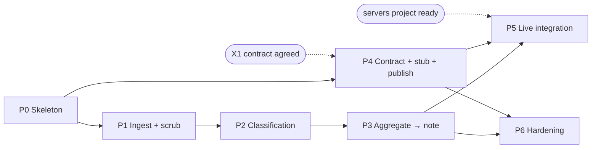

# Groww Review Pulse — Implementation Plan

> Phase-by-phase build plan for the agent described in [architecture.md](architecture.md),
> delivering the requirements in [problemStatement.md](problemStatement.md).
> Status: **Phases 0–3 complete; Phase 4 next (needs X1 agreed).** Last updated: 2026-10-12.

---

## 0. How to use this plan

| Document | Answers |
| --- | --- |
| [problemStatement.md](problemStatement.md) | *What* must be true when we're done, and *why* |
| [architecture.md](architecture.md) | *How* the system is shaped, and which decisions are settled |
| **this file** | *In what order* we build it, task by task, and *how we know each step works* |

Every task carries an ID (`P2-T4`) so it can be referenced in commits and reviews. Tasks are
written to be completable in one sitting and verifiable by a command, not by inspection.

**Conventions used below:**

- `✅ Exit:` a command whose success closes the phase. If it can't be run, the phase isn't done.
- `⚠️` a known trap worth reading before writing the code.
- `🔗` a dependency on a decision or another phase.
- Estimates assume one developer fluent in Python, working from this plan. They are effort, not
  calendar time.

---

## 1. Before Phase 0: decisions that gate work

Three open items from architecture.md §20. Only one of them actually blocks starting.

| Item | Blocks | Can we start without it? |
| --- | --- | --- |
| **O1** — which concrete Play Store export, in what format | Phase 1 real data | **Yes.** Build against the canonical internal format and a synthetic fixture (P1-T1); the real parser is a contained adapter change later. |
| **X1** — contract `pulse-mcp/1` sign-off | Phase 4 | **Yes for phases 0–3.** Needs agreement before Phase 4 starts. Start the review now — it's a document review, not an implementation. |
| **O3** — Gmail draft recipient | Phase 5 only | Yes. Config value. |

**The one thing to do today, in parallel with Phase 0:** send architecture.md §11.2 to whoever owns
the servers project and get X1 agreed. It is the only cross-project dependency, it costs them a
read, and it has four phases of lead time. Leaving it until Phase 4 is the most likely way this
plan slips.

### Environment prerequisites

```bash
python --version                  # need 3.11+
ant auth status                   # or export ANTHROPIC_API_KEY
```

If `ant auth status` reports an active profile, no API key env var is needed — the SDK picks the
profile up from a bare `anthropic.Anthropic()`.

---

## 2. Phase dependency graph



Note **P4 depends only on P0**, not on P3. The MCP half and the analysis half are independent after
the skeleton exists — if two people are available, that's the split. The only true serialization is
P1 → P2 → P3.

| Phase | Deliverable | Est. | Blocked externally? |
| --- | --- | --- | --- |
| P0 | Skeleton, models, config, CLI, `doctor` | 0.5–1 d | No |
| P1 | File-drop ingest, normalize, scrub | 1.5–2 d | No (synthetic fixture) |
| P2 | Classification + caching | 1.5 d | No |
| P3 | Aggregate, draft, validate, render, `--dry-run` | 2.5–3 d | No |
| P4 | Contract, stub server, MCP client, publish | 2–2.5 d | Needs X1 agreed |
| P5 | Live integration | 0.5–1 d | **Yes** — servers project |
| P6 | Hardening, golden tests, ledger, docs | 1–1.5 d | No |
| | **Total** | **~10–13 d** | |

---

## 3. Phase 0 — Skeleton ✅ COMPLETE (2026-10-11)

**Goal:** a runnable, installed CLI with the complete data model and config loading, so every later
phase is filling in behaviour rather than inventing structure.

| ID | Task | Files | Done |
| --- | --- | --- | --- |
| P0-T1 | `git init`; `.gitignore` covering `data/raw/`, `runs/`, `.cache/`, `__pycache__`, `.venv` | `.gitignore` | ✅ |
| P0-T2 | `pyproject.toml`: src layout, `pulse` package, `pulse` console script, pinned deps | `pyproject.toml` | ✅ |
| P0-T3 | Transcribe the full data model from architecture.md §7 verbatim | `src/pulse/models.py` | ✅ |
| P0-T4 | Config loading: TOML + env, with a typed `Settings` model and clear errors on missing required values | `src/pulse/config.py`, `config/*.toml` | ✅ |
| P0-T5 | CLI skeleton (Typer): `run`, `validate`, `doctor`, `contract check` — all wired, most raising `NotImplementedError` | `src/pulse/cli.py` | ✅ |
| P0-T6 | Run directory + ledger helpers: allocate `runs/<week>-<nn>/`, write/read stage artifacts, append to `run.json` | `src/pulse/orchestrator.py` | ✅ |
| P0-T7 | Structured logging setup (stdlib `logging` + JSON formatter), `run_id` on every record | `src/pulse/logging.py` | ✅ |
| P0-T8 | `pulse doctor`: checks Python version, Anthropic credential resolution, input path, config parse. MCP probes stubbed as "not implemented (P4)" | `src/pulse/doctor.py`, `src/pulse/cli.py` | ✅ |
| P0-T9 | Model round-trip tests: each model accepts a valid payload and rejects an invalid one | `tests/test_models.py` | ✅ |
| P0-T10 | Dev tooling: `ruff`, `mypy`, `pytest` config; one CI workflow running all three | `pyproject.toml`, `.github/workflows/ci.yml` | ✅ |

### What landed beyond the task list — Phase 0

| Addition | Why |
| --- | --- |
| `src/pulse/doctor.py` as its own module | Checks are unit-testable without invoking Typer, and detection stays separate from presentation. P0-T8 named `cli.py`; the command lives there, the checks do not. |
| `README.md` | `pyproject.toml`'s `readme =` field makes it an install-time requirement — the package will not build without it. Expanded further in P1-T2 and P6-T5. |
| `RunLedger`, `StageRecord`, `LlmUsage` in `models.py` | P0-T6 needs a typed ledger; architecture.md §16 specifies its contents. |
| `IsoWeek` constrained type | Turns the ISO-year boundary trap into a validation error at the stage boundary that caused it. |
| `tests/test_config.py`, `test_orchestrator.py`, `test_doctor.py` | The phase exit criterion is `pytest -q`, which is only meaningful if config loading and run-dir allocation are actually covered. |
| `config/themes.toml` ↔ `Theme` enum consistency check | The enum enforces the ≤5 constraint; the config builds the classifier prompt. Drift between them surfaces as confusing classification failures rather than as the config error it is. |
| `ruff format` + `extend-exclude = ["docs"]` | Formatting is in CI. `docs/` is excluded because ruff reformats the Python snippets inside the design documents. |

### Deviations from architecture.md §7 (document updated to match)

| Change | Reason |
| --- | --- |
| `StrEnum` instead of `(str, Enum)` | `f"{Theme.APP_RELIABILITY}"` renders as `"Theme.APP_RELIABILITY"` under `(str, Enum)`. §8.1 renders theme names into the classifier prompt, so that would degrade classification silently. Pydantic JSON and schema output are identical either way. Pinned by a test. |
| `extra="forbid"` on `Review` | Makes the structural PII defence loud. The default would silently drop an `author=` an adapter passed in — safe, but it hides the bug. |
| `iso_week: IsoWeek` instead of `str` | As above. |

**Dependencies to pin** (P0-T2):

```toml
dependencies = [
  "pydantic>=2.9",
  "anthropic>=1.0",
  "mcp>=1.2",
  "typer>=0.12",
]
[project.optional-dependencies]
dev = ["pytest>=8", "pytest-asyncio>=0.24", "ruff>=0.6", "mypy>=1.11"]
```

⚠️ **Do not add any `google-*` package, ever.** P6-T1 enforces this with a test, but the habit
starts here. If something seems to need one, the need belongs in the servers project.

⚠️ `tomllib` is in the 3.11 stdlib — no `tomli` dependency needed.

**Cardinality note for P0-T3:** architecture.md §7 writes the list constraints as
`Field(min_length=3, max_length=3)`. In Pydantic v2 those are the correct keyword names for
sequence length (`min_items`/`max_items` are the v1 spelling and are rejected). Keep v2 spelling.

```bash
# ✅ Exit — all verified 2026-10-11
pip install -e ".[dev]"      # installs clean
pulse doctor                 # reports env status truthfully, exits 0 or 1 with reasons
pytest -q                    # 140 passed
ruff check . && ruff format --check . && mypy src
```

On a machine with no Anthropic credential, `pulse doctor` exits 1 with
`FAIL anthropic-auth` plus warnings for the absent review export and draft recipient.
That is the correct result, not a setup problem — the credential is first needed in
Phase 2, and the warnings track open decisions O1 and O3.

---

## 4. Phase 1 — Ingest, normalize, scrub ✅ COMPLETE (2026-10-11)

**Goal:** a corpus of normalized, PII-free `Review` objects on disk, from a file the user drops in.

This is where the privacy constraint is actually won or lost, so the scrubber gets disproportionate
test attention.

| ID | Task | Files | Done |
| --- | --- | --- | --- |
| P1-T1 | **Synthetic fixture corpus**: ~250 reviews across 12 ISO weeks, realistic Groww-flavoured text, deliberate PII samples, rating skew, a few duplicates and a few empty-text rows | `tests/fixtures/reviews_sample.json` | ✅ 263 rows |
| P1-T2 | Declare the canonical input format (the JSON/CSV shape the file-drop adapter reads) and document it in the README | `docs/input-format.md`, `README.md` | ✅ |
| P1-T3 | `ReviewSource` protocol + adapter registry; registry is explicit, no auto-discovery | `src/pulse/ingest/base.py` | ✅ |
| P1-T4 | File-drop adapter: JSON and CSV, directory or single file, emits `RawReview[]` | `src/pulse/ingest/file_drop.py` | ✅ +TSV |
| P1-T5 | Normalization: rating coercion/clamping, date parsing → `submitted_on` + `iso_week`, `review_id` content hash, drop empty-text rows, dedupe | `src/pulse/ingest/normalize.py` | ✅ |
| P1-T6 | Window filter + window validation (abort if span < `PULSE_MIN_WINDOW_WEEKS`) | `src/pulse/ingest/normalize.py` | ✅ |
| P1-T7 | Scrubber layers 1–3 from architecture.md §10, each pattern a named, individually testable rule | `src/pulse/analysis/scrub.py` | ✅ 13 rules |
| P1-T8 | `scan_for_pii(text) -> list[PiiHit]` — the detector used both by the scrubber and by the §9 pre-publish rescan. One implementation, two callers | `src/pulse/analysis/scrub.py` | ✅ |
| P1-T9 | Wire stages 1–3 into the orchestrator, writing `01_raw.json`, `02_normalized.json`, `03_scrubbed.json` | `src/pulse/pipeline.py`, `src/pulse/cli.py` | ✅ |
| P1-T10 | `test_scrub.py` — positive table (every PII class redacted) **and** negative table | `tests/test_scrub.py` | ✅ 124 tests |
| P1-T11 | `test_normalize.py` — dedupe, week assignment incl. year boundary, window abort, rating clamp | `tests/test_normalize.py` | ✅ 70 tests |

### What landed beyond the task list — Phase 1

| Addition | Why |
| --- | --- |
| `src/pulse/pipeline.py` as its own module | P1-T9 named `orchestrator.py`, but putting stage dispatch there would break the layering rule in architecture.md §5 — `orchestrator` owns run dirs and the ledger and must not import `ingest/` or `analysis/`. Composition lives here instead. |
| `scripts/make_fixture.py` | The fixture is generated from a committed, seeded script, so it can be regenerated and diffed rather than hand-edited. Verified byte-identical on re-run. |
| `docs/input-format.md` | P1-T2 said "document it in the README". The format needs a full page (aliases, date formats, drop reasons, dedupe rule); the README links to it. |
| `tests/test_ingest.py`, `tests/test_pipeline.py` | P1-T10/11 cover scrub and normalize. The adapter and the wired pipeline needed their own, including artifact-level privacy assertions. |
| Scrub **idempotence** as a tested property | Found a real bug: `self_contact` re-matched its own `[contact]` placeholder, which would have made stage 7's pre-publish rescan abort good runs. Now no rule may claim an already-redacted span. |
| `assert_clean()` + `PiiHit.masked()` | Stage 7 (P3-T15) needs to report a leak without echoing the leak into logs. Tested. |
| TSV support, UTF-8 BOM tolerance | One line each; spreadsheet exports routinely carry a BOM, which would otherwise corrupt the first column header. |

### Deviations and discoveries

| Item | Detail |
| --- | --- |
| **Identity columns dropped at ingest, not stage 2** | Architecture.md §18 accepted PII in `01_raw.json`. The adapter is stricter: recognised identity columns never reach any artifact. Free, since nothing downstream wants them. §18 and §10 updated. The raw artifact is still sensitive — PII *inside review bodies* survives to stage 3 — so O6 still matters. |
| **Title is never concatenated with text** | `Review.text` must be a contiguous span of real reviewer prose, because stage 7 verifies quotes as exact substrings of it. A synthetic `title + ". " + body` join would let a "verbatim" quote straddle punctuation nobody wrote. Title is used only when text is absent. |
| **`self_name` split into two rules** | The stopword guard was wrongly applied to "my name is", where whatever follows *is* a name — it silently refused to redact "My name is Not A Realperson". Explicit triggers now redact unconditionally; weak triggers ("I am") require capitalization *and* pass a stopword list, because neither guard alone holds ("I am giving 2 stars" vs "I am Unable to login"). |
| **Plan's ISO-week example was wrong** | This document claimed 2026-12-31 is `2027-W01`; it is `2026-W53`. Corrected above, with verified boundary cases. |

### Implementation notes — Phase 1

**The fixture must be synthetic.** Committing real Play Store reviews would put third-party text —
and plausibly real PII — into the repo, which is the exact thing this project promises not to do.
Write the fixture by hand or generate it; make the PII in it obviously fake (`+91 90000 00000`,
`notareal@example.com`). This also makes the negative tests honest, because we know the ground
truth.

**`review_id` definition** (P1-T5): `sha256(source + "|" + normalized_text + "|" + submitted_on)`,
first 16 hex chars. Deliberately excludes rating and title so an edited rating doesn't fork the id,
and excludes any reviewer field so the id is never identity-derived. Dedupe on this hash.

⚠️ **ISO week boundaries.** Use `date.isocalendar()` and format as `f"{year}-W{week:02d}"`, taking
the ISO year from `isocalendar()[0]`, **not** `date.year`. Getting this wrong silently misfiles
reviews at the year boundary and corrupts the baseline. Verified cases where the ISO year differs
from the calendar year: 2027-01-01 → `2026-W53`, 2025-12-29 → `2026-W01`, 2021-01-01 → `2020-W53`.
(An earlier draft of this plan claimed 2026-12-31 is `2027-W01`; it is `2026-W53` — corrected in
P0 after checking against `isocalendar()` rather than by hand.)

⚠️ **Scrubber ordering matters.** Run specific patterns before the catch-all digit-run rule, or
`[number]` will swallow phone numbers and PANs before their own rules see them. Order: email → URL
→ UPI handle → PAN → Aadhaar → IFSC → phone → account → `@handle` → long-digit catch-all.

⚠️ **Negative cases are not optional.** A scrubber that redacts `₹5000`, `T+1`, `24x7`, `2 stars`,
or `SBI` destroys legitimate review text and will quietly degrade every quote. P1-T10's negative
table is as important as its positive table.

```bash
# ✅ Exit — all verified 2026-10-11
pytest -q                 # 399 passed (124 scrub, 70 normalize, 44 ingest, 21 pipeline)
ruff check . && ruff format --check . && mypy src
pulse run --dry-run --input tests/fixtures/reviews_sample.json --week 2026-W41 --from 01 --to 03
# → runs/2026-W41-01/{01_raw,02_normalized,03_scrubbed}.json
```

**Privacy verification on the artifact**, not just in unit tests: grepping
`03_scrubbed.json` for email shapes, bare `@handles`, and every value the fixture planted
returns nothing. Long digit runs do appear — all 17 are digit substrings of the 16-char hex
`review_id` content hashes, which exclude every reviewer field by construction; zero occur
in review text. `tests/test_pipeline.py` asserts both halves of this, plus that the fixture
really does still contain the PII the scrubber is claimed to remove (without which the
leak test could pass against an empty fixture).

Corpus over the fixture: 263 rows → 261 ingested → 242 normalized (17 duplicates, 2 ratings
clamped, 2 rows dropped) → 241 scrubbed, spanning 13 weeks, 22 PII hits across 10 rules.

---

## 5. Phase 2 — Classification ✅ COMPLETE (2026-10-12)

**Goal:** every review in the corpus labelled with one of the five themes or `None`, cheaply and
repeatably.

**Provider changed to Groq** (architecture.md D6a), decided 2026-10-11, to build without
per-token spend. `LlmPort` keeps a switch back a config change.

| ID | Task | Files | Done |
| --- | --- | --- | --- |
| P2-T1 | **`LlmPort` protocol** + provider implementation + `FakeLlm` for tests. Usage/cost accounting lives here | `src/pulse/llm.py` | ✅ `GroqLlm`, `FakeLlm`, `NullLlm` |
| P2-T2 | Taxonomy prompt: the five themes with inclusion/exclusion guidance and a worked example each. Stable text — it's the cache prefix | `src/pulse/prompts/taxonomy.py` | ✅ |
| P2-T3 | `ClassificationBatch` wrapper model; batched classification | `src/pulse/analysis/classify.py` | ✅ |
| P2-T4 | Prompt caching, where the provider supports it | `src/pulse/analysis/classify.py` | ✅ conditional — Groq has none |
| P2-T5 | Classification cache keyed by `(review_id, taxonomy_version)` in `.cache/classify.json` | `src/pulse/analysis/classify.py` | ✅ + model in the key |
| P2-T6 | Confidence floor (< 0.5 → `theme = None`); per-batch validation retry then mark unclassified | `src/pulse/analysis/classify.py` | ✅ |
| P2-T7 | Record tokens, cost, and cache hit rate into the run ledger | `src/pulse/pipeline.py` | ✅ |
| P2-T8 | Wire stage 4; write `04_classified.json` | `src/pulse/pipeline.py` | ✅ |
| P2-T9 | Tests with `FakeLlm`: batching splits correctly, cache hit avoids a second call, low confidence → `None`, invalid theme → retry path | `tests/test_classify.py` | ✅ 35 + 17 prompt tests |
| P2-T10 | **One-time**: run real classification over the fixture corpus and commit the result as a golden artifact for P3/P6 | `tests/fixtures/classified_golden.json` | ✅ 241 labels, $0.0083 |

### What landed beyond the task list — Phase 2

| Addition | Why |
| --- | --- |
| Adaptive `json_schema` → `json_object` fallback | Which Groq models accept a `json_schema` response format is model-dependent and the published accounts disagree. The client tries schema mode, falls back permanently for the run on a 400, and logs once. Client-side Pydantic validation makes the difference retry count, never correctness. |
| **Index-based reconciliation** instead of `review_id` echo | Deviation from architecture.md §8.1, documented there. A 1-based batch index is far harder for a model to corrupt than a 16-char hex hash, an out-of-range index is detectable where a plausible wrong hash is not, and it costs fewer output tokens. Missing / duplicate / spurious indices each become `None` and are counted. |
| Model in the cache key | The plan keyed on `(review_id, taxonomy_version)`. Adding the model prevents serving labels from one judge while a run uses another — which would quietly undermine the O5 comparison. |
| `pulse models [--probe]` | Picks the model by asking the account instead of assuming. `--probe` spends ~30 tokens per model testing real schema support. |
| `--llm` / `--no-cache` flags, `NullLlm` | Offline development and explicit failure when no provider is set. |
| Provider-aware `doctor` | Was Anthropic-specific; a hardcoded check would make `doctor` lie about a correctly configured run. |

### Bugs the tests caught

| Bug | Impact if shipped |
| --- | --- |
| `cache = cache or ClassificationCache(...)` | `ClassificationCache` defines `__len__`, so an **empty cache is falsy** — the caller's cache, including `--no-cache`, was silently discarded and replaced with one at the default path. Fixed to `is None`; the same hazard fixed for the injected `LlmPort`. |
| `ConfigError` escaped the run handler | A misconfiguration found *during* a stage left the ledger at `status: "running"` forever, indistinguishable from a crashed process, breaking §15's partial-failure handling. |

### Implementation notes — Phase 2

**Why `LlmPort` (P2-T1) even though the architecture doesn't name it.** Stages 4 and 6 are the only
non-deterministic steps, and both need to be testable in CI without spending tokens or flaking.
A narrow port with a `FakeLlm` makes the regeneration loop in P3 testable at all — you can script
"return a paraphrased quote, then a verbatim one" and assert the loop behaves. This is a plan-level
addition, consistent with the architecture's deterministic-spine stance.

**Settings for the classification call** (from architecture.md §8.1): `model="claude-opus-5-5"`,
`output_config={"effort": "low"}`, `max_tokens=8000`, batch ~40 reviews.

⚠️ **Verify caching actually works.** After the first batch, assert
`usage.cache_read_input_tokens > 0`. If it's zero on every batch, something volatile has leaked into
the prefix — a timestamp, an unsorted `json.dumps`, a per-batch count in the system text. The cache
is what makes weekly re-runs nearly free (the 8–12 week window overlaps ~90% between runs), so a
silent cache miss is a real cost regression, not a cosmetic one.

⚠️ **Don't let the cache outlive the taxonomy.** The cache key includes `taxonomy_version`; bump
that value in `config/themes.toml` whenever theme definitions change, or you'll serve labels from a
taxonomy that no longer exists.

🔗 **O5** (cheaper model for bulk classification) becomes measurable here. Don't pre-empt it: get
correct labels from `claude-opus-5-5` first, then — if cost matters — compare a cheaper model
against this phase's output on the same corpus and decide with numbers.

```bash
# ✅ Exit — P2-T1..T9 verified 2026-10-11, entirely offline
pytest -q                 # 465 passed (35 classify, 17 prompt, 28 pipeline)
ruff check . && ruff format --check . && mypy src
```

Stages 1-4 verified end to end over the fixture with a scripted provider: 241 reviews,
7 batches, zero missing/duplicate/spurious indices, theme counts populated in the ledger.
A replay of stage 4 makes **no** API call (cache hit rate 1.0) — the property that makes
weekly re-runs nearly free.

**P2-T10 complete** — real classification over the 241-review fixture on
`openai/gpt-oss-120b`, committed as `tests/fixtures/classified_golden.json` and pinned by
`tests/test_golden_classification.py`:

| Measure | Result |
| --- | --- |
| Batches / API calls | 7 / 7, **zero** retries, **zero** batch failures |
| Reconciliation anomalies | 0 missing, 0 spurious, 0 duplicate indices |
| Unclassified | 5 of 241 (2.1%) — **all five are the fixture's adapter-test rows**, which genuinely have no theme. The model declined rather than guessing. |
| Theme spread | 16–25% each; the taxonomy fits the corpus |
| Confidence | cleanly bimodal — 0.1–0.6 for the five declines, 0.8–1.0 for the rest |
| Cost | **$0.0083** (13.6k in / 8.3k out) |
| Wall time | ~120s |

The cache-read assertion from the original plan does not apply on Groq, which has no cache
breakpoint; the report records `prompt_cache_supported: false` rather than implying a miss.

### Model selection — probing beat assuming

`pulse models` found the account offers **neither Kimi K2 nor Llama 4**, the two families
secondary sources named as the schema-capable ones. Of the five usable chat models,
`openai/gpt-oss-120b` was chosen: strongest available, strict `json_schema` once the schema
is reshaped. `qwen/qwen3.8-27b` is the alternative — also strict, and with no reasoning
overhead.

### Quality caveat, reported rather than tuned away

3 of 64 distinct review texts received **different labels in different batches**, all at
genuine taxonomy seams ("OTP never arrives" sits between `app_reliability` and
`onboarding_kyc`). That is ~5% label noise flowing into Phase 3's theme counts. Left
unfixed deliberately: the fixture is synthetic, so sharpening the prompt against it would
be optimising for fiction. Revisit when real reviews are available (O1).

---

## 6. Phase 3 — Aggregate, draft, validate, render ✅ COMPLETE (2026-10-12)

**Goal:** `pulse run --dry-run` produces a compliant one-page note on disk. This is the phase that
satisfies most of the acceptance checklist.

Largest phase; build it in three ordered slices.

### 3a — Aggregation (deterministic)

| ID | Task | Files |
| --- | --- | --- |
| P3-T1 | Per-theme weekly stats: count, share, mean rating, negative volume | `src/pulse/analysis/aggregate.py` |
| P3-T2 | Trailing baseline + `delta_vs_baseline` from the rolling window | `src/pulse/analysis/aggregate.py` |
| P3-T3 | Ranking score from architecture.md §8.2, with documented tie-breaks | `src/pulse/analysis/aggregate.py` |
| P3-T4 | Quote candidate pool: 4-step filter, top 8 per theme | `src/pulse/analysis/aggregate.py` |
| P3-T5 | Thin-week abort (< 20 reviews) and the no-quotable-candidate fallback to the 4th theme | `src/pulse/analysis/aggregate.py` |
| P3-T6 | `test_aggregate.py`: ranking determinism, tie-breaks, delta can't promote a 3-review theme over a 100-review one, candidate filters | `tests/test_aggregate.py` |

### 3b — Draft and render

| ID | Task | Files |
| --- | --- | --- |
| P3-T7 | Draft system prompt: word budget, verbatim-copy instruction, action grounding | `src/pulse/prompts/draft.py` |
| P3-T8 | Draft input renderer — top 3 themes, stats, candidate pools only. **Never the full corpus** | `src/pulse/analysis/draft.py` |
| P3-T9 | `PulseNote` generation via `messages.parse()`, `effort: "high"` | `src/pulse/analysis/draft.py` |
| P3-T10 | Markdown renderer — one template, the single source for both doc and email bodies | `src/pulse/rendering/render.py` |
| P3-T11 | `test_render.py`: stable output for a fixed `PulseNote`, CommonMark only (no tables/HTML — §11.2 limits the servers to basic marks) | `tests/test_render.py` |

### 3c — The validation gate

| ID | Task | Files |
| --- | --- | --- |
| P3-T12 | `count_note_words()` implementing architecture.md §9's definition exactly, with its own tests | `src/pulse/rendering/validate.py` |
| P3-T13 | Verbatim check: whitespace-normalize both sides, require an exact substring match in exactly one candidate | `src/pulse/rendering/validate.py` |
| P3-T14 | Remaining checks: provenance, distinctness, theme validity, action grounding | `src/pulse/rendering/validate.py` |
| P3-T15 | PII rescan via P1-T8's detector → **abort**, not retry | `src/pulse/rendering/validate.py` |
| P3-T16 | Regeneration loop: ≤3 attempts, each retry carrying the specific failures as feedback; write `07_validation.json` | `src/pulse/orchestrator.py` |
| P3-T17 | `test_validate.py`: paraphrase rejected, verbatim accepted, 251 words rejected / 250 accepted, wrong cardinality rejected, duplicate-source quotes rejected | `tests/test_validate.py` |
| P3-T18 | Loop test with `FakeLlm`: scripted fail-then-pass succeeds; three failures abort without publishing | `tests/test_draft_loop.py` |

### Implementation notes — Phase 3

⚠️ **The verbatim check is the highest-value test in the repo.** Write P3-T17 before P3-T13 and
watch it fail. A model asked for "verbatim" quotes will tidy punctuation, fix spelling, and merge
clauses — all of which look fine to a human reviewer and all of which violate a hard requirement.
Normalize only whitespace before comparing; do **not** normalize case or punctuation, or the check
stops checking the thing that matters.

⚠️ **Word count must be one function with one definition.** If the prompt's budget and the
validator's count disagree even slightly, the loop will fail in ways that look like model
disobedience. Implement `count_note_words()` first, state its rule in the draft prompt, and test
the boundary at exactly 250 and 251.

⚠️ **Feedback, not retries.** `"Try again"` produces a differently-wrong note. The retry message
must name what failed: which quote wasn't verbatim, what the measured word count was, which theme
was out of range.

**Render target is deliberately plain.** §11.2 commits the servers only to headings, bold/italic,
bullets, block quotes, and links. Rendering a markdown table here would produce something the Docs
server isn't contracted to handle.

```bash
# ✅ Exit — all verified 2026-10-12
pytest -q          # 607 passed (25 aggregate, 54 validate, 15 render, 14 draft loop)
ruff check . && ruff format --check . && mypy src
pulse run --dry-run --input tests/fixtures/reviews_sample.json --week 2026-W41
pulse validate     # re-gates the stored note: passes
```

The produced note, measured rather than asserted: **238 words**, 3 themes, 3 quotes, 3
actions, no PII, every quote verbatim with correct provenance. Accepted on the **first**
attempt — the regeneration loop was not needed, though `test_draft_loop.py` scripts it.

### What landed beyond the task list — Phase 3

| Addition | Why |
| --- | --- |
| `QuoteCandidate` model | §7 typed `quote_candidates` as `list[str]`, which made §9's provenance check unimplementable. See the bug below. |
| Stage 7 runnable standalone | Fused into stage 6 for the retry loop, but also registered on its own so `pulse validate` can re-gate a stored artifact. Makes a published note auditable after the fact. |
| `05_stats.json` stores the **full** ranking | Not just the top three, so "why wasn't payments on the page?" is answerable from the artifact rather than by re-running. |
| `generated_on` as a parameter | Rendering must be a pure function of its inputs, or the P6 golden test could never compare two renders. |
| `readability_score()` | The candidate pool needs a deterministic order; the model picks from a pre-vetted set, so what gets into that set is a code decision. |
| `render_email_body()`, `email_subject()` | Stage 10 needs them in Phase 4; cheap to write beside the renderer they share a template with. |

### The bug this phase found

**The model fabricated quote provenance.** The verbatim check protected the quote *text*
and nothing else — so `Quote.review_id` and `Quote.rating` were fields the model filled in
freely. In a real run it invented ids (`r001`, `r002`, `r003`) that existed nowhere in the
corpus, and guessed star ratings: "Onboarding is clean and fast" was published as **2★**
when the source review was **5★**, and an unanswered-ticket complaint as **4★** when it was
**2★**.

A verbatim quote under a fabricated rating is still a misleading artifact. Root cause was an
inconsistency in the architecture itself: §9 specified a provenance check that §7's
text-only candidate type made impossible to write. Candidates now carry provenance, stage 7
**derives** both fields from the matched review rather than trusting them, and the number of
corrections is recorded in the ledger — a model that invents ids is worth knowing about even
when the correction is automatic.

At this point problemStatement.md §8 is satisfied **except** the two MCP delivery lines.

---

## 7. Phase 4 — Contract, stub server, MCP client, publish

🔗 **Requires X1 agreed** (not implemented) before starting.

**Goal:** stages 9–10 fully working against an in-repo stub, so live integration is later a config
change.

| ID | Task | Files |
| --- | --- | --- |
| P4-T1 | Write `pulse-mcp/1` as JSON Schema — four tools, inputs and outputs, error-code enum | `contract/pulse-mcp-1.json` |
| P4-T2 | Share it with the servers project; confirm it is the mirrored canonical copy (🔗 X3) | — |
| P4-T3 | Stub MCP server: in-memory docs store, find/create/replace with real revision semantics, `create_draft`; advertises contract version in `initialize` | `tests/stubs/stub_mcp_server.py` |
| P4-T4 | Stub fault injection: force any error code (`AUTH_REQUIRED`, `REVISION_MISMATCH`, `RATE_LIMITED`, …) via env var or tool arg | `tests/stubs/stub_mcp_server.py` |
| P4-T5 | `ClientSession` lifecycle over stdio, with timeouts | `src/pulse/mcp/session.py` |
| P4-T6 | Discovery: `list_tools()`, contract-version check (warn on minor, abort on major), configured-name resolution with a helpful failure listing actual names | `src/pulse/mcp/discovery.py` |
| P4-T7 | `DocsPort` / `GmailPort` protocols + `McpDocsAdapter` / `McpGmailAdapter`. **Only file in the repo that knows a tool name** | `src/pulse/mcp/adapters.py` |
| P4-T8 | Validate every tool response against the contract schema before use (architecture.md §18 trust boundary) | `src/pulse/mcp/adapters.py` |
| P4-T9 | Stage 9: find-then-create/replace, title convention `Groww Review Pulse — <ISO week>`; `REVISION_MISMATCH` reports the conflict rather than overwriting | `src/pulse/publish/docs.py` |
| P4-T10 | Stage 10: draft only, body = full note + doc link | `src/pulse/publish/gmail.py` |
| P4-T11 | `RATE_LIMITED` honoured via `retry_after_seconds`, ≤3 attempts | `src/pulse/publish/` |
| P4-T12 | Partial-failure handling: doc succeeded + draft failed is recorded and resumable with `--from 10` | `src/pulse/orchestrator.py` |
| P4-T13 | `--mcp stub` / `--mcp live` switch; startup probe runs **before** any LLM call | `src/pulse/cli.py` |
| P4-T14 | `pulse contract check` | `src/pulse/cli.py` |
| P4-T15 | Real `doctor` MCP probes, replacing the P0 stubs | `src/pulse/cli.py` |
| P4-T16 | `test_mcp_contract.py` — stub's advertised schemas match the contract file | `tests/test_mcp_contract.py` |
| P4-T17 | `test_publish.py` — happy path, idempotent re-run, and each error code's handling | `tests/test_publish.py` |
| P4-T18 | `test_mcp_discovery.py` — missing tool, version mismatch (minor and major) | `tests/test_mcp_discovery.py` |

### Implementation notes — Phase 4

**Build the stub before the client.** It is the executable form of the contract; writing it first
surfaces ambiguities in §11.2 while they're still cheap to fix — and any ambiguity you find is one
the servers project would otherwise hit later.

⚠️ **Probe ordering is a cost control, not a nicety.** The startup probe must run before stage 4.
Discovering an unauthorized server after classifying 1,200 reviews wastes the whole run's spend.
Test this explicitly: configure a failing server and assert zero LLM calls happened.

⚠️ **Idempotency is ours.** The servers are permitted to be dumb about it. The re-run test (P4-T17)
must assert the same document URL comes back, not merely that a doc exists — otherwise a weekly job
scatters duplicates across Drive and nobody notices for a month.

🔗 **X4**: if the Docs server can't supply a stable `revision`, drop `if_revision` and accept
last-write-wins. Decide with the servers project rather than silently sending `null`.

```bash
# ✅ Exit
pytest -q                                              # incl. contract, publish, discovery
pulse contract check
pulse run --mcp stub --input tests/fixtures/reviews_sample.json
pulse run --mcp stub --input tests/fixtures/reviews_sample.json   # same doc URL, no duplicate
```

---

## 8. Phase 5 — Live integration

🔗 **Blocked on the servers project.** The only phase that is.

**Goal:** a real Google Doc and a real Gmail draft.

| ID | Task | Files |
| --- | --- | --- |
| P5-T1 | Resolve X2 (how the servers are distributed) and point `config/mcp.toml` at them | `config/mcp.toml` |
| P5-T2 | Set `PULSE_RECIPIENT` (🔗 O3) and `folder_id` if used (🔗 O4) | env, `config/pulse.toml` |
| P5-T3 | `pulse doctor` against live servers; drive the authorization path end to end | — |
| P5-T4 | Full live run; verify the doc renders correctly and the draft contains note + link | — |
| P5-T5 | Re-run and confirm in-place update, same URL | — |
| P5-T6 | Run the P4 contract tests against the **live** servers (the one cross-project test row) | `tests/test_mcp_contract.py` |
| P5-T7 | Record any contract deviations found; fix in whichever project is wrong, bump version if the contract itself changes | `contract/`, architecture.md §11.2 |

⚠️ **Expect the first live run to find at least one contract gap.** Markdown fidelity and error
shapes are the usual suspects. That's the stub's job done correctly — it moved the discovery from
"mysterious production failure" to "a test disagrees with a schema."

⚠️ **Verify the draft was not sent.** Check the Gmail Drafts folder, not Sent. There is no send tool
in the contract, so this should be structurally impossible — confirm it anyway, once.

```bash
# ✅ Exit
pulse doctor                     # both live servers reachable, contract OK
pulse run                        # real doc URL + real draft id in the ledger
pulse run                        # same doc URL
```

---

## 9. Phase 6 — Hardening

**Goal:** green from a clean checkout; every acceptance-checklist line verifiable.

| ID | Task | Files |
| --- | --- | --- |
| P6-T1 | `test_no_google_sdk.py` — fail if `googleapiclient`, `google-auth`, `google-api-python-client`, or `oauth2client` resolve in the dependency tree | `tests/test_no_google_sdk.py` |
| P6-T2 | Golden end-to-end test: fixture corpus + committed classification → note render, fully offline | `tests/test_golden.py` |
| P6-T3 | Complete the run ledger: corpus size, per-theme counts, tokens, cost, cache rate, attempts, doc URL, draft id, wall time | `src/pulse/orchestrator.py` |
| P6-T4 | End-of-run cost summary line, with cache hit rate called out | `src/pulse/cli.py` |
| P6-T5 | README: install, configure, drop an export, run, interpret output, troubleshoot | `README.md` |
| P6-T6 | Runbook: weekly operation, scheduling (cron/CI), what to do on each failure mode in architecture.md §15 | `docs/runbook.md` |
| P6-T7 | Decide and implement O6 (raw-artifact retention) — prune or document the retention of `01_raw.json` | `src/pulse/orchestrator.py` |
| P6-T8 | Walk problemStatement.md §8 line by line, tick each with the command that proves it | `docs/problemStatement.md` |
| P6-T9 | Capture one real pulse as a reviewed sample output (PII-checked before committing) | `docs/sample-pulse.md` |

⚠️ **P6-T7 is the last privacy loose end.** `01_raw.json` is the one artifact that may contain PII
as exported. Either prune it after a successful run or document explicitly why it's retained and
for how long. Don't leave it undecided.

```bash
# ✅ Exit — from a clean clone
git clone <repo> && cd agent-mcp
pip install -e ".[dev]"
pytest -q                        # everything green, no network, no servers project
pulse run --dry-run --input tests/fixtures/reviews_sample.json
```

---

## 10. Traceability: acceptance criteria → phase

Every line of problemStatement.md §8, mapped to where it gets satisfied and what proves it.

| Acceptance criterion | Phase | Proof |
| --- | --- | --- |
| Play Store reviews, last 8–12 weeks, public export | P1 | `test_normalize.py` window tests; `Source` enum |
| Clustered into ≤5 themes | P2 | `Theme` enum; `test_models.py` |
| Note ≤250 words | P3 | `count_note_words()`; `test_validate.py` boundary at 250/251 |
| Top 3 themes | P3 | `test_aggregate.py` ranking; `PulseNote` cardinality |
| 3 verbatim quotes, no PII | P3 | `test_validate.py` paraphrase rejection + PII rescan |
| 3 action ideas tied to themes | P3 | `PulseNote` cardinality + action-grounding check |
| Published to a Google Doc via MCP | P4 (stub) → P5 (live) | `test_publish.py`; live run |
| Gmail draft via MCP with note or link | P4 (stub) → P5 (live) | `test_publish.py`; Drafts folder |
| No PII in any artifact | P1 + P3 | `test_scrub.py` both tables; pre-publish rescan |
| No direct Google REST/OAuth path | P4 | All Google access via `pulse-mcp/1` |
| No Google SDK in the dependency tree | P6 | `test_no_google_sdk.py` |

---

## 11. Risk register

| Risk | Likelihood | Impact | Mitigation |
| --- | --- | --- | --- |
| **O1 never resolves** — no compliant public Play export is found | Medium | High — the pipeline has no real input | The canonical-format + synthetic-fixture approach means everything downstream is built and tested regardless. Escalate early: this is a sourcing question, not an engineering one, and it is the project's one unsolved premise. |
| **X1 stalls** — contract not agreed by Phase 4 | Medium | Medium | Send §11.2 for review on day 1. P4 has four phases of lead time; nothing else depends on it. |
| Servers project late | Medium | Low | Only P5 blocks. P6 can run before P5. |
| Model won't produce verbatim quotes reliably | **High** | Medium | Expected, not exceptional. Candidate pool + substring check + feedback loop; if 3 attempts prove insufficient in practice, narrow the pool and sharpen the prompt rather than loosening the check. |
| Prompt cache silently missing | Medium | Medium (cost) | Assert `cache_read_input_tokens > 0` in P2; surface the rate in every run summary. |
| Scrubber over-redacts, degrading quotes | Medium | Medium | Negative test table (P1-T10); candidate filter drops placeholder-containing reviews. |
| Thin target week produces a meaningless note | Low | Low | < 20 reviews aborts (P3-T5). |
| Theme taxonomy doesn't fit the real corpus | Medium | Medium | Visible at P2 on real data. Change enum members and bump `taxonomy_version`; do not add a sixth theme. |
| Contract gaps found only at P5 | **High** | Low | By design — the stub converts these into schema disagreements instead of production failures. |

The two rows worth re-reading are the first and the fourth. The first is the only risk that can
make the project undeliverable, and it is not something code can fix. The fourth is near-certain but
fully handled — it's the reason the validation gate exists.

---

## 12. Suggested commit sequence

One commit per task where practical, prefixed with the task ID:

```text
P0-T2: add pyproject with pinned deps and src layout
P0-T3: add Pydantic data model from architecture §7
P1-T7: add PII scrubber layers 1-3
P1-T10: add scrub test tables, positive and negative
P3-T13: enforce verbatim quotes by substring verification
P4-T3: add stub MCP server implementing pulse-mcp/1
```

**Definition of done for any task:** code written, tests written and passing, `ruff` and `mypy`
clean, and — if the task touched a documented decision — architecture.md updated in the same commit.

Keep the architecture document current as you build. Where implementation proves a design decision
wrong, change the decision in architecture.md and note why; a plan that silently diverges from its
architecture leaves neither document trustworthy.
